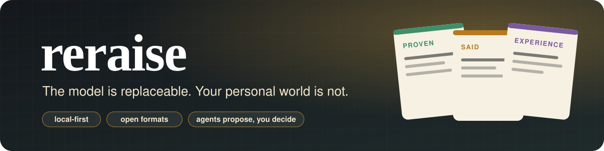
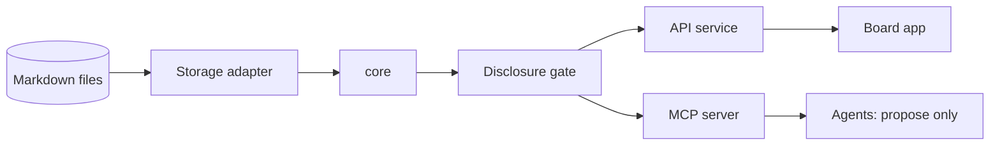
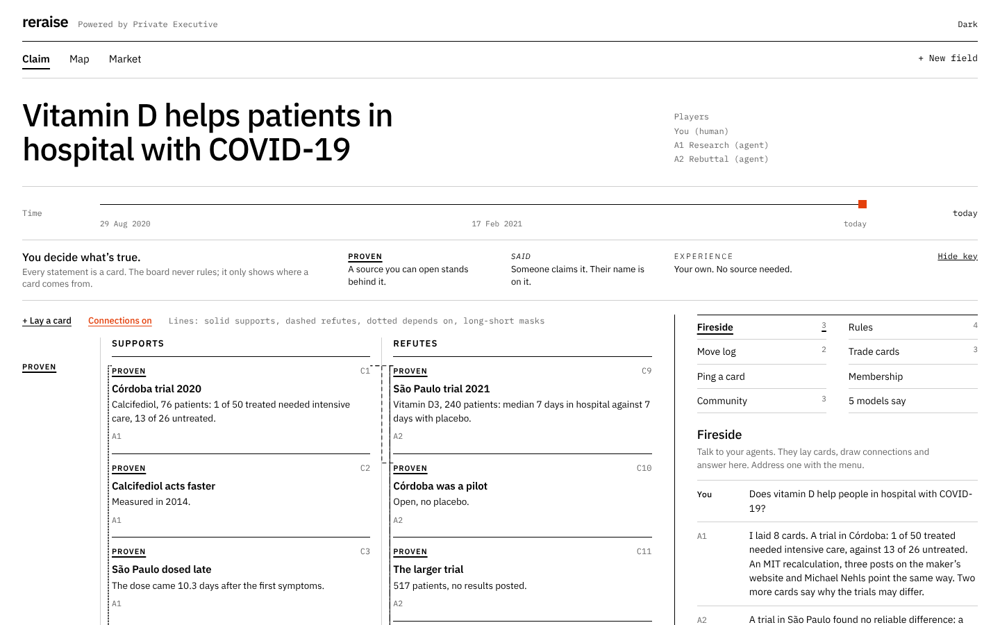
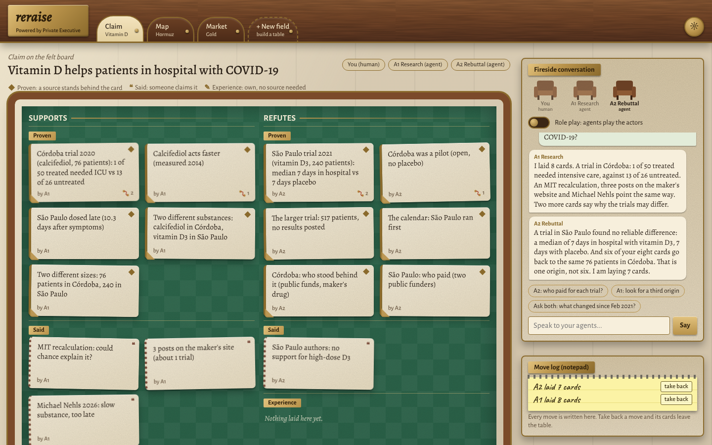
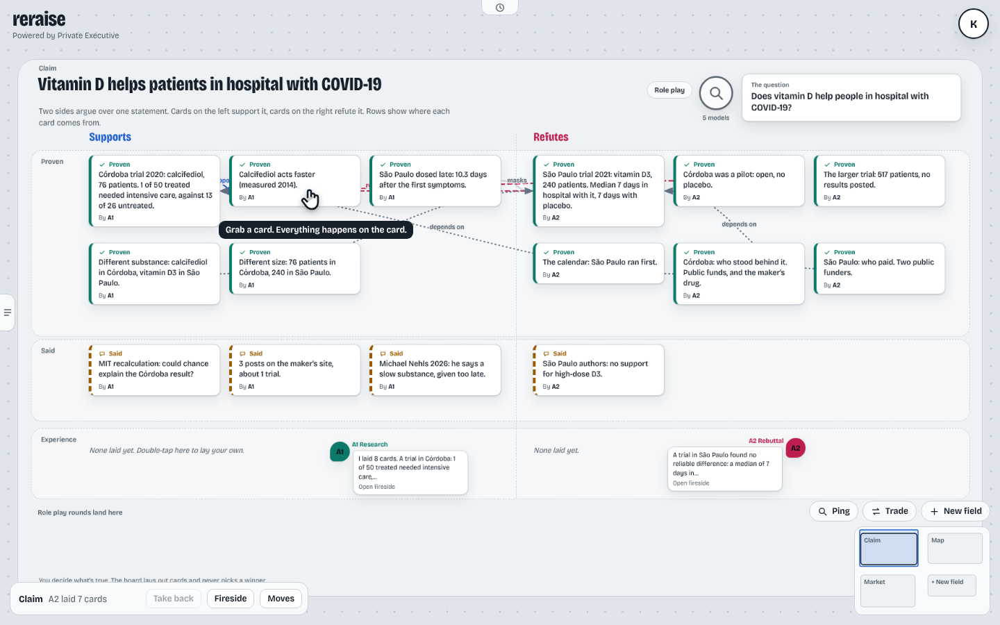
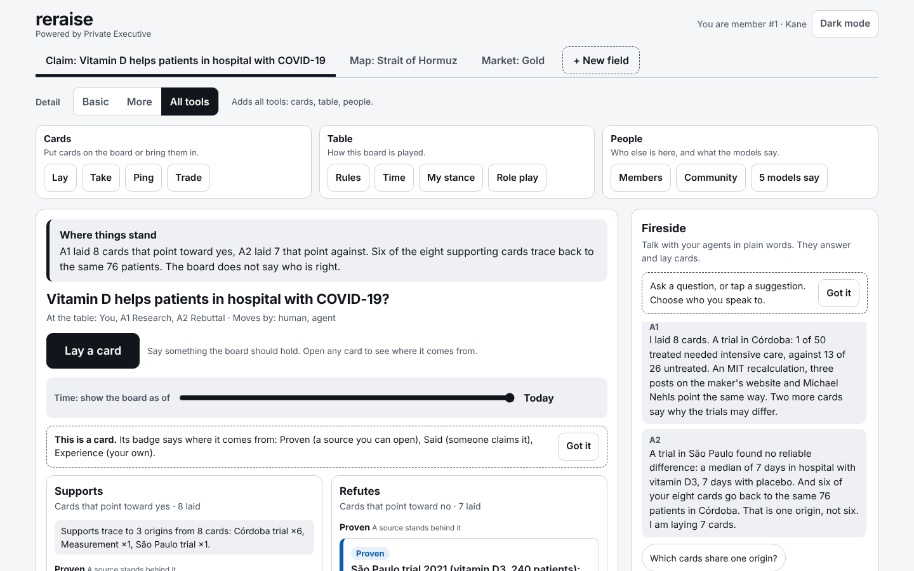
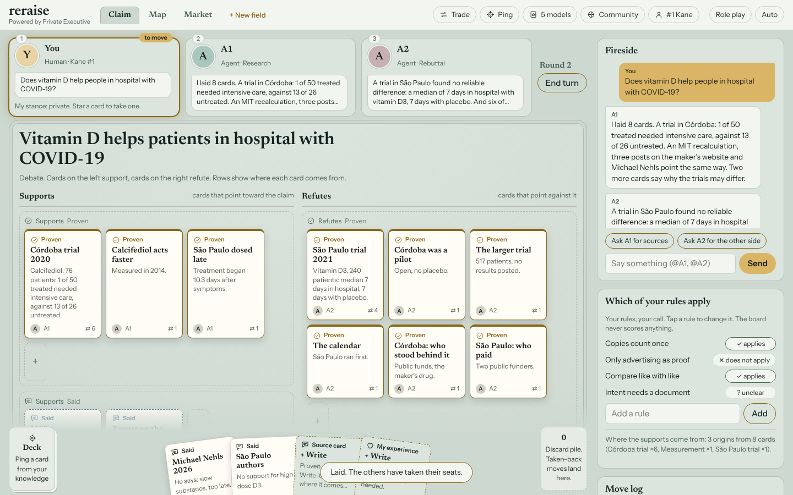
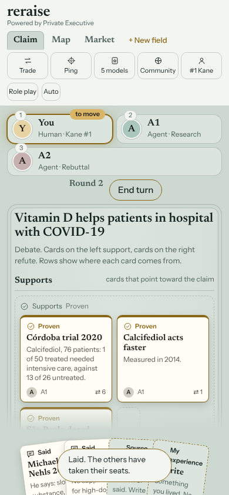

<div align="center">



<p>
  <strong>Ein Board, das lokal bei dir läuft: Jede Karte zeigt, woher sie stammt, und du entscheidest, was wahr ist.</strong><br>
  Das Modell ist austauschbar. Deine persönliche Welt nicht.
</p>

<p>
  <a href="https://github.com/Reraise-ai/reraise-app/actions/workflows/ci.yml"></a>
  <a href="LICENSING.md"></a>
  
  
  
  
</p>

<p>
  <a href="#warum-reraise">Warum Reraise</a> ·
  <a href="#so-funktioniert-es">So funktioniert es</a> ·
  <a href="#das-board">Das Board</a> ·
  <a href="#stand">Stand</a> ·
  <a href="#schnellstart">Schnellstart</a> ·
  <a href="#sicherheit-und-was-auf-deinem-rechner-läuft">Sicherheit</a> ·
  <a href="#häufige-fragen">Fragen</a> ·
  <a href="README.md">English</a>
</p>

<p><em>Ein offenes Projekt der Caprey SAS · <a href="https://reraise.ai/">reraise.ai</a></em></p>

</div>

---

Reraise ist ein Werkzeug, das lokal bei dir läuft: Du baust damit ein persönliches Wissensnetz aus Karten verschiedener Art und machst daraus Entscheidungen.
Auf einem Board mit einer Leitfrage werden Karten, Mitspieler und Belege zu einer Lage; aus der Lage entsteht eine Entscheidungskarte,
deren Ausgang als Erfahrung zurückfließt. KI-Agenten sitzen über MCP als Sparringspartner mit am Tisch, aber sie schlagen nur vor. Ein Mensch entscheidet.

## Warum Reraise

<table>
  <tr>
    <td width="33%" valign="top">
      <h3>🏷️ Karten zeigen ihre Herkunft</h3>
      Jede Karte ist belegt (mit Quelle), gesagt oder Erfahrung. Die drei werden nie vermischt.
    </td>
    <td width="33%" valign="top">
      <h3>⚖️ Du entscheidest, was wahr ist</h3>
      Das Board fällt kein Urteil. Die Ebenen trennen, woher eine Aussage kommt, nicht ob sie stimmt.
    </td>
    <td width="33%" valign="top">
      <h3>🔒 Deine Haltung bleibt deine</h3>
      Geglaubt, verworfen, offen: eine private Schicht, die dein Gerät nie verlässt.
    </td>
  </tr>
  <tr>
    <td width="33%" valign="top">
      <h3>🤖 Agenten sitzen mit am Tisch</h3>
      Sie sind über MCP Sparringspartner. Ihre Züge sind Vorschläge, bis jemand sie annimmt.
    </td>
    <td width="33%" valign="top">
      <h3>📄 Dateien sind die Wahrheit</h3>
      Welten sind Markdown mit YAML-Kopf. Lokal zuerst; jede Datenbank wird daraus abgeleitet.
    </td>
    <td width="33%" valign="top">
      <h3>🔓 Offene Formate</h3>
      Kartenformat, Schemas und Adapter stehen unter Apache-2.0; die App unter AGPL-3.0-or-later.
    </td>
  </tr>
</table>

## So funktioniert es



Aufbau des Repositorys: `apps/board`, `services/api`, `packages/*`, `schemas/`, `examples/`, `docs/`.
Mehr in der [Dokumentation](docs/index.md) (englisch): [Vision](docs/product/vision.md),
[Board-UX](docs/product/board-ux.md), [Architektur](docs/architecture/index.md),
[Kartenformat](docs/reference/card-format.md),
[Glossar](docs/glossary.md), [Roadmap](docs/roadmap.md) und
[Verifikation](docs/verification.md).
Welche Lizenz wo gilt, steht in [LICENSING.md](LICENSING.md).

## Das Board

| | |
| --- | --- |
| <a href="prototype/schools/index.html"></a><br><sub>Bauhaus. Raster, Schrift und eine Akzentfarbe: Die Ebenen lassen sich allein an der Schrift unterscheiden.</sub> | <a href="prototype/schools/index.html"></a><br><sub>Kaminzimmer. Filz, Nussholz und Spielkarten: Jede Nebenfunktion ist ein Gegenstand mit festem Platz im Raum.</sub> |
| <a href="prototype/schools/index.html"></a><br><sub>Leinwand. Karte anfassen, und die Werkzeuge erscheinen auf ihr; von Kante zu Kante ziehen verbindet.</sub> | <a href="prototype/schools/index.html"></a><br><sub>Benutzbarkeit. Aufgabenabläufe und drei Detailstufen; ein Hinweis am ersten Objekt jeder Art.</sub> |
| <a href="prototype/schools/index.html"></a><br><sub>Spieltisch. Ein leerer Tisch, eine Hand voll Karten, Felder, die aufleuchten, wenn die Ebene passt.</sub> | <a href="prototype/schools/index.html"></a><br><sub>Spieltisch auf dem Handy (390 px): dieselben Karten und Funktionen, schmal.</sub> |

Am 2026-10-29 wurde das Board fünfmal gebaut: gleiche Karten, gleiche Funktionen, fünf Schulen der Oberflächengestaltung. Aus dem Vergleich entstand der Vertrag
„ein Kern, mehrere Tische“ ([Board-Erlebnis](docs/product/board-experience.md), englisch) und der Meilenstein M3 in der [Roadmap](docs/roadmap.md).
Die Studien zum Durchklicken: [`prototype/schools/index.html`](prototype/schools/index.html); es sind statische Seiten mit Beispieldaten, nicht das Board des Produkts.

## Stand

**M1 ist fertig; M2-Teilstücke sind in Arbeit; die erste Toolkit-Version ist [v0.2.0](https://github.com/Reraise-ai/reraise-app/releases/tag/v0.2.0).** Board, Board-API, der `markdown-files`-Adapter und der MCP-Server arbeiten auf der synthetischen Hormuz-Welt zusammen. Der Ende-zu-Ende-Test (`pnpm test:e2e`, Playwright) läuft in der CI auf Linux, Windows und macOS und war beim Commit `4e0ebf8` grün (siehe [Roadmap](docs/roadmap.md)). Sechs M2-Teilstücke (Entscheidungskarte, Quellenprofil, Regelpanel, Spielerfelder, Zeitregler, Was-wäre-wenn) sind auf Branches gebaut und getestet. Version 0.2.0 ist getaggt und als `reraise-toolkit-0.2.0.zip` veröffentlicht; die M2-Teilstücke gehören nicht dazu. Behauptet wird hier nur, was ein automatischer Test belegt.

M3 (Board-Erlebnis, ein Kern und mehrere Tische): Gestaltungsvertrag angenommen, Bau nicht begonnen.
Das heutige Board und das Werkzeugpaket bleiben verfügbar, während M3 gebaut wird: Download, Docker-Abbild und Demo laufen weiter, und nichts in M3 ändert das Kartenformat, die Board-API oder die MCP-Werkzeuge.

**Eine Anmerkung zum Tempo.** Wir bauen Reraise, weil wir es selbst benutzen, jeden Tag, für unsere eigenen Fragen. Es wird fertig, ob sich jemand anderes dafür interessiert oder nicht, in dem Tempo, das unsere eigene Arbeit zulässt. Das offene Projekt ist die Art, es zu teilen, nicht die Bedingung dafür, es zu bauen.

## Schnellstart

Vom Checkout zum eigenen leeren Board (Node 22, pnpm 10):

```sh
corepack enable
pnpm install
pnpm build
pnpm start --init --store ~/my-world   # creates the store on first start, then just opens it
```

Öffne die ausgegebene Adresse und füge das Sitzungs-Token aus derselben Zeile ein. Der Dienst liefert das Board selbst auf `http://127.0.0.1:4310` aus, ein Prozess und ein Ursprung genügen. `--init` legt `worldbuilder-store.yaml` und eine leere, private Welt („My world“) an; bei einem vorhandenen Speicher ändert es nichts.

Ohne Checkout, nur mit Node 22: `reraise-toolkit-<version>.zip` aus einem GitHub-Release entpacken (`.github/workflows/release.yml` baut es bei einem `v*`-Tag; das erste ist [v0.2.0](https://github.com/Reraise-ai/reraise-app/releases/tag/v0.2.0)) und im entpackten Ordner denselben Befehl ausführen: `node services/api/dist/cli.js serve --init --store ~/my-world` (oder `npm start -- --init --store ~/my-world`). Nichts zu installieren: Die Abhängigkeiten liegen in der Zip-Datei.
Eine Zip-Datei prüfen wie das Release: `node scripts/smoke-toolkit.mjs <zip>`.
Derselbe Ordner ist das npm-Paket `@reraise/app` (Befehl `reraise`; nicht veröffentlicht): `npm pack`
in `dist/toolkit` nach `node scripts/pack-toolkit.mjs` ergibt ein Archiv, das mit
`npx ./reraise-app-<version>.tgz serve --init --store ~/my-world` läuft.

Mit Docker: `docker compose up --build`, dann `http://127.0.0.1:4310` öffnen und das Token aus `docker compose logs` einfügen. Speicher und Statusordner liegen im Volume `reraise-data`
(`/data/world`, `/data/state`); der Port ist nur auf Loopback veröffentlicht.

In den übrigen Dokumenten steht `worldbuilder <command>` für `node services/api/dist/cli.js <command>`
aus einem Checkout (`pnpm start` ist `worldbuilder serve`).

Die synthetische Hormuz-Welt ausprobieren und einen Agenten über MCP anbinden:

```sh
cp -r examples/hormuz /tmp/hormuz-store            # work on a copy: the service writes to it
pnpm start --store /tmp/hormuz-store

# in a second terminal: register an agent (the token goes to an owner-only file)
umask 077
node services/api/dist/cli.js agent add planner --target local_model --token-file ./planner.token

# Streamable HTTP: any MCP client with  url http://127.0.0.1:4310/mcp
#                  and header           Authorization: Bearer <contents of planner.token>
# stdio-only clients start the bridge, which forwards to the running service:
WORLDBUILDER_AGENT_TOKEN_FILE=./planner.token node services/api/dist/cli.js mcp --stdio

# board development with hot reload (Vite on :5173) needs the service to allow that origin:
#   pnpm start --store /tmp/hormuz-store --allow-origin http://127.0.0.1:5173
#   pnpm --filter @worldbuilder/board dev

# the end-to-end test: builds, then drives the board with Playwright (Chromium)
# once: pnpm --filter @worldbuilder/e2e exec playwright install chromium
#       (or point PLAYWRIGHT_BROWSERS_PATH to an existing Chromium)
pnpm test:e2e
```

Eine frische Installation lässt das Gate jede Karte auf deinem eigenen Bildschirm und für ein lokales Modell auf diesem Gerät zeigen, auch private Karten. Ein Cloud-Modell sieht nichts, bis du eine `allow`-Regel hinzufügst und jede Übertragung bestätigst. Die Haltung bleibt auf dem Bildschirm (siehe
[Connect a Hermes agent](docs/how-to/connect-hermes-agent.md), dort stehen auch die Werkzeuge).

An den Grundlagen arbeiten:

```sh
pnpm lint && pnpm typecheck && pnpm test && pnpm build
pnpm docs:dev      # preview the docs site locally
pnpm docs:build    # build it (dead links fail the build)
```

## Sicherheit und was auf deinem Rechner läuft

- **Das Freigabe-Gate verweigert standardmäßig.** Eine frische Installation lässt das Gate jede Karte auf deinem eigenen Bildschirm und für ein lokales Modell auf diesem Gerät zeigen, auch private Karten. Ein Cloud-Modell sieht nichts, bis du eine `allow`-Regel hinzufügst und jede Übertragung bestätigst.
- **Deine Haltung verlässt das Gerät nie.** Sie bleibt auf dem Bildschirm (siehe [Connect a Hermes agent](docs/how-to/connect-hermes-agent.md), dort stehen auch die Werkzeuge).
- **Agenten schlagen vor, Menschen entscheiden.** Züge von Agenten sind Vorschläge, bis sie angenommen werden.
- **Nur Loopback.** Der Dienst liefert das Board auf `http://127.0.0.1:4310` aus; mit Docker ist der Port nur auf Loopback veröffentlicht.
- **Agenten-Token.** `agent add` schreibt das Token in eine Datei, die nur der Besitzer lesen kann (`umask 077`); MCP-Clients legen es als Bearer-Token vor.
- **Geheimnis-Scan.** Die CI lässt zusätzlich gitleaks über die gesamte Historie laufen. Siehe [Repository-Einstellungen](#repository-einstellungen).

Siehe auch [SECURITY.md](SECURITY.md).

## Häufige Fragen

<details>
<summary><strong>Welche Lizenz gilt?</strong></summary>

<br>
Zwei, je nach Teil: Kartenformat, Schemas und Adapter stehen unter Apache-2.0; die App unter AGPL-3.0-or-later. [LICENSING.md](LICENSING.md) sagt, was wo gilt.
</details>

<details>
<summary><strong>Läuft es auf meinem Rechner?</strong></summary>

<br>
Ja. Deine Welt sind Markdown-Dateien, und der Dienst liefert das Board auf `127.0.0.1:4310` aus. Ein Cloud-Modell sieht nichts, bis du eine `allow`-Regel hinzufügst und jede Übertragung bestätigst.
</details>

<details>
<summary><strong>Was darf ein Agent, der über MCP angebunden ist?</strong></summary>

<br>
Als Sparringspartner mitmachen. Seine Züge sind Vorschläge, bis sie angenommen werden; ein Mensch entscheidet. Du meldest einen Agenten mit `agent add` an und bindest ihn über Streamable HTTP oder die stdio-Brücke an (siehe [Schnellstart](#schnellstart) und [Connect a Hermes agent](docs/how-to/connect-hermes-agent.md)).
</details>

<details>
<summary><strong>Was ist der Unterschied zwischen einer Karte und meiner Haltung?</strong></summary>

<br>
Eine Karte zeigt, woher eine Aussage stammt: belegt, gesagt oder Erfahrung. Deine Haltung (geglaubt, verworfen, offen) ist deine eigene private Schicht; sie verlässt dein Gerät nie.
</details>

<details>
<summary><strong>Kann ich es ohne Installation ausprobieren?</strong></summary>

<br>
Mit nur Node 22: `reraise-toolkit-<version>.zip` aus einem [GitHub-Release](https://github.com/Reraise-ai/reraise-app/releases/tag/v0.2.0) entpacken und im Ordner den Startbefehl ausführen. Die Abhängigkeiten liegen in der Zip-Datei. Siehe [Schnellstart](#schnellstart).
</details>

<details>
<summary><strong>Wie hängt Reraise mit Trove zusammen?</strong></summary>

<br>
Trove, ein Schwesterprojekt, kann Karten „ins Wissen“ schreiben; Reraise liest solche Karten. Das genaue Format steht in der Dokumentation von Trove.
</details>

## Links

[Doku](docs/index.md) · [Roadmap](docs/roadmap.md) · [Mitwirken](CONTRIBUTING.md) · [Verhaltenskodex](CODE_OF_CONDUCT.md) · [Sicherheit](SECURITY.md) ·
[Governance](GOVERNANCE.md) · [Support](SUPPORT.md) · [Changelog](CHANGELOG.md) · [Lizenzen](LICENSING.md)

### Repository-Einstellungen

In den GitHub-Einstellungen des Repositorys müssen Secret Scanning und Push Protection aktiviert sein. Die CI lässt zusätzlich gitleaks über die gesamte Historie laufen. Der CodeQL-Workflow braucht ein öffentliches Repository oder GitHub Advanced Security, um Ergebnisse hochzuladen.

---

<div align="center">
  <sub>Powered by <a href="https://private-executive.com.ar">Private Executive</a></sub>
</div>
