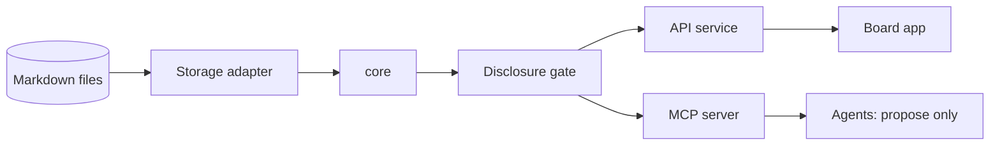

# The Worldbuilder

[](#status)
[](LICENSING.md)

> The model is replaceable. Your personal world is not.

## 30-second pitch

The Worldbuilder is a local-first tool for building a personal knowledge graph of typed
cards, and for turning it into decisions. Every card shows where it comes from: evidenced,
said, or experience. Your own stance (believed, rejected, undecided) is a private overlay
that never leaves your device. On a board with a guiding question, cards, players and
evidence become a situation; from the situation comes a decision card whose outcome flows
back as experience. AI agents take part as sparring partners through MCP, but they only
propose. A human decides.

## Status

**M0 in progress.** This repository currently contains the foundations: licensing,
community files, tooling and package skeletons. There is no usable product yet, and no
feature is claimed here that is not backed by an automated test.

## What and why

- **Files are the truth.** Worlds are Markdown with YAML front matter; any database is derived.
- **Provenance is explicit.** Evidence, hearsay and experience are never mixed.
- **Privacy by design.** A disclosure gate denies by default; cloud models need per-transfer confirmation.
- **Agents propose, humans decide.** Agent moves are proposals until accepted.
- **Open formats.** Card format, schemas and adapters are Apache-2.0; the app is AGPL-3.0-or-later.

## Architecture at a glance



Monorepo layout: `apps/board`, `services/api`, `packages/*`, `schemas/`, `examples/`, `docs/`.
See [LICENSING.md](LICENSING.md) for which licence applies where.

## Quickstart

Available from M1. Until then, to work on the foundations:

```sh
corepack enable
pnpm install
pnpm lint && pnpm typecheck && pnpm test && pnpm build
```

## Repository settings

GitHub secret scanning and push protection must be enabled in the repository settings.

## Links

[Contributing](CONTRIBUTING.md) · [Code of Conduct](CODE_OF_CONDUCT.md) · [Security](SECURITY.md) ·
[Governance](GOVERNANCE.md) · [Support](SUPPORT.md) · [Changelog](CHANGELOG.md) · [Licensing](LICENSING.md)
