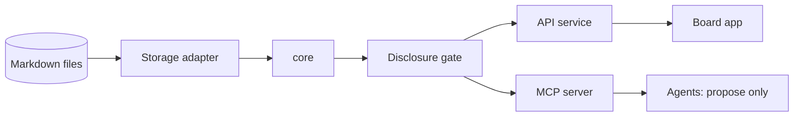

<div align="center">


<p>
  <strong>A local-first board where every card shows where it comes from, and you decide what is true.</strong><br>
  The model is replaceable. Your personal world is not.
</p>

<p>
  <a href="https://github.com/Reraise-ai/reraise-app/actions/workflows/ci.yml"></a>
  <a href="LICENSING.md"></a>
  
  
  
  
</p>

<p>
  <a href="#why-reraise">Why Reraise</a> ·
  <a href="#how-it-works">How it works</a> ·
  <a href="#the-board">The board</a> ·
  <a href="#status">Status</a> ·
  <a href="#quick-start">Quick start</a> ·
  <a href="#safety-and-what-runs-on-your-machine">Safety</a> ·
  <a href="#faq">FAQ</a> ·
  <a href="README.de.md">Deutsch</a>
</p>

<p><em>An open project by Caprey SAS · <a href="https://reraise.ai/">reraise.ai</a></em></p>

</div>

---

Reraise is a local-first tool for building a personal knowledge graph of typed cards, and for turning it into decisions.
On a board with a guiding question, cards, players and evidence become a situation; from the situation comes a decision card
whose outcome flows back as experience. AI agents take part as sparring partners through MCP, but they only propose. A human decides.

## Why Reraise

<table>
  <tr>
    <td width="33%" valign="top">
      <h3>🏷️ Cards show where they come from</h3>
      Every card is proven (evidenced), said, or experience. The three are never mixed.
    </td>
    <td width="33%" valign="top">
      <h3>⚖️ You decide what's true</h3>
      The board gives no verdict. The layers separate where a statement comes from, not whether it is true.
    </td>
    <td width="33%" valign="top">
      <h3>🔒 Your stance stays yours</h3>
      Believed, rejected, undecided: a private overlay that never leaves your device.
    </td>
  </tr>
  <tr>
    <td width="33%" valign="top">
      <h3>🤖 Agents sit at the table</h3>
      They take part as sparring partners through MCP. Their moves are proposals until accepted.
    </td>
    <td width="33%" valign="top">
      <h3>📄 Files are the truth</h3>
      Worlds are Markdown with YAML front matter. Local-first; any database is derived.
    </td>
    <td width="33%" valign="top">
      <h3>🔓 Open formats</h3>
      Card format, schemas and adapters are Apache-2.0; the app is AGPL-3.0-or-later.
    </td>
  </tr>
</table>

## How it works



Monorepo layout: `apps/board`, `services/api`, `packages/*`, `schemas/`, `examples/`, `docs/`.
More in the [documentation](docs/index.md): [vision](docs/product/vision.md),
[board UX](docs/product/board-ux.md), [architecture](docs/architecture/index.md),
[card format](docs/reference/card-format.md),
[glossary](docs/glossary.md), [roadmap](docs/roadmap.md) and
[verification](docs/verification.md).
The 333 source-checked Health cards are in [`cards/health/`](cards/health/README.md); the tool that checks cards against their sources is in [`tools/source-check/`](tools/source-check/README.md).
See [LICENSING.md](LICENSING.md) for which licence applies where.

## The board

| | |
| --- | --- |
| <a href="prototype/schools/index.html">Bauhaus.</b> Grid, type and one accent colour: layers can be told apart by type alone." width="100%"></a><br><sub><b>Bauhaus.</b> Grid, type and one accent colour: layers can be told apart by type alone.</sub> | <a href="prototype/schools/index.html">Fireside room.</b> Felt, walnut and playing cards: every side function is an object with a place in the room." width="100%"></a><br><sub><b>Fireside room.</b> Felt, walnut and playing cards: every side function is an object with a place in the room.</sub> |
| <a href="prototype/schools/index.html">Canvas.</b> Grab a card and the tools appear on it; draw from edge to edge to connect." width="100%"></a><br><sub><b>Canvas.</b> Grab a card and the tools appear on it; draw from edge to edge to connect.</sub> | <a href="prototype/schools/index.html">Usability.</b> Task flows and three detail levels; one hint on the first object of each kind." width="100%"></a><br><sub><b>Usability.</b> Task flows and three detail levels; one hint on the first object of each kind.</sub> |
| <a href="prototype/schools/index.html">Tabletop.</b> An empty table, a hand of cards, slots that light up when the layer fits." width="100%"></a><br><sub><b>Tabletop.</b> An empty table, a hand of cards, slots that light up when the layer fits.</sub> | <a href="prototype/schools/index.html">Tabletop on a phone</b> (390 px): the same cards and functions, narrow." width="100%"></a><br><sub><b>Tabletop on a phone</b> (390 px): the same cards and functions, narrow.</sub> |

On 2026-10-29 the board was built five times: same cards, same functions, five schools of interface design. From that comparison comes the contract
"one core, several tables" ([board experience](docs/product/board-experience.md)) and milestone M3 in the [roadmap](docs/roadmap.md).
Click through the studies in [`prototype/schools/index.html`](prototype/schools/index.html); they are static pages with sample data, not the product board.

## Status

**M1 is done; M2 slices are in progress; the first toolkit release is [v0.2.0](https://github.com/Reraise-ai/reraise-app/releases/tag/v0.2.0).** The board, the Board API, the `markdown-files` adapter and the MCP server work together on the synthetic Hormuz world. The end-to-end test (`pnpm test:e2e`, Playwright) runs in CI on Linux, Windows and macOS and was green at commit `4e0ebf8` (see the [roadmap](docs/roadmap.md)). Six M2 slices (decision card, source profile, rules panel, player fields, time slider, what-if) are built and tested on branches. Version 0.2.0 is tagged and released as `reraise-toolkit-0.2.0.zip`; the M2 slices are not part of it. No feature is claimed here that is not backed by an automated test.

M3 (board experience, one core and several tables): design contract adopted, build not started.
The current board and the toolkit stay available while M3 is built: the download, the Docker image and the demo keep working, and nothing in M3 changes the card format, the Board API or the MCP tools.

**A note on pace.** We build Reraise because we use it ourselves, every day, to think through our own questions. It gets finished whether or not anyone else shows up, at whatever pace our own work allows. The open project is how we share it, not a condition for building it.

## Quick start

From a checkout to your own empty board (Node 22, pnpm 10):

```sh
corepack enable
pnpm install
pnpm build
pnpm start --init --store ~/my-world   # creates the store on first start, then just opens it
```

Open the URL it prints and paste the session token from the same line. The service serves the
board itself on `http://127.0.0.1:4310`, so one process and one origin are enough. `--init`
creates `worldbuilder-store.yaml` and one empty, private world ("My world"); on an existing store
it changes nothing.

Without a checkout, with Node 22 only: unpack `reraise-toolkit-<version>.zip` from a GitHub
release (`.github/workflows/release.yml` builds it on a `v*` tag; the first is [v0.2.0](https://github.com/Reraise-ai/reraise-app/releases/tag/v0.2.0)) and run the
same command in that folder: `node services/api/dist/cli.js serve --init --store ~/my-world` (or
`npm start -- --init --store ~/my-world`). Nothing to install: the dependencies are in the zip.
To check a zip the way the release does: `node scripts/smoke-toolkit.mjs <zip>`.
The same folder is the npm package `@reraise/app` (command `reraise`; not published): `npm pack`
in `dist/toolkit` after `node scripts/pack-toolkit.mjs` gives a tarball that runs with
`npx ./reraise-app-<version>.tgz serve --init --store ~/my-world`.

With Docker: `docker compose up --build`, then open `http://127.0.0.1:4310` and paste the token
from `docker compose logs`. Store and state directory live in the volume `reraise-data`
(`/data/world`, `/data/state`); the port is published on loopback only.

In the other docs, `worldbuilder <command>` stands for `node services/api/dist/cli.js <command>`
from a checkout (`pnpm start` is `worldbuilder serve`).

To try the synthetic Hormuz world and connect an agent over MCP:

```sh
cp -r examples/hormuz /tmp/hormuz-store            # work on a copy: the service writes to it
pnpm start --store /tmp/hormuz-store

# in a second terminal: register an agent (the token goes to an owner-only file)
umask 077
node services/api/dist/cli.js agent add planner --target local_model --token-file ./planner.token

# Streamable HTTP: any MCP client with  url http://127.0.0.1:4310/mcp
#                  and header           Authorization: Bearer <contents of planner.token>
# stdio-only clients start the bridge, which forwards to the running service:
WORLDBUILDER_AGENT_TOKEN_FILE=./planner.token node services/api/dist/cli.js mcp --stdio

# board development with hot reload (Vite on :5173) needs the service to allow that origin:
#   pnpm start --store /tmp/hormuz-store --allow-origin http://127.0.0.1:5173
#   pnpm --filter @worldbuilder/board dev

# the end-to-end test: builds, then drives the board with Playwright (Chromium)
# once: pnpm --filter @worldbuilder/e2e exec playwright install chromium
#       (or point PLAYWRIGHT_BROWSERS_PATH to an existing Chromium)
pnpm test:e2e
```

A fresh installation lets the gate show every card on your own screen and to a local model
on this device, including private cards. A cloud model sees nothing until you add an `allow`
rule and confirm each transfer. Stance stays on the screen (see
[Connect a Hermes agent](docs/how-to/connect-hermes-agent.md), which also lists the tools).

To work on the foundations:

```sh
pnpm lint && pnpm typecheck && pnpm test && pnpm build
pnpm docs:dev      # preview the docs site locally
pnpm docs:build    # build it (dead links fail the build)
```

## Safety and what runs on your machine

- **The disclosure gate denies by default.** A fresh installation lets the gate show every card on your own screen and to a local model on this device, including private cards. A cloud model sees nothing until you add an `allow` rule and confirm each transfer.
- **Your stance never leaves.** Stance stays on the screen (see [Connect a Hermes agent](docs/how-to/connect-hermes-agent.md), which also lists the tools).
- **Agents propose, humans decide.** Agent moves are proposals until accepted.
- **Loopback only.** The service serves the board on `http://127.0.0.1:4310`; with Docker the port is published on loopback only.
- **Agent tokens.** `agent add` writes the token to an owner-only file (`umask 077`); MCP clients present it as a Bearer token.
- **Secret scanning.** CI additionally runs gitleaks over the full history. See [Repository settings](#repository-settings).

See also [SECURITY.md](SECURITY.md).

## FAQ

<details>
<summary><strong>Which licence applies?</strong></summary>

<br>
Two, by part: card format, schemas and adapters are Apache-2.0; the app is AGPL-3.0-or-later. [LICENSING.md](LICENSING.md) says which applies where.
</details>

<details>
<summary><strong>Does it run on my machine?</strong></summary>

<br>
Yes. Reraise is local-first: your world is Markdown files, and the service serves the board on `127.0.0.1:4310`. A cloud model sees nothing until you add an `allow` rule and confirm each transfer.
</details>

<details>
<summary><strong>What can an agent connected over MCP do?</strong></summary>

<br>
Take part as a sparring partner. Agent moves are proposals until accepted; a human decides. You register an agent with `agent add` and connect it by Streamable HTTP or the stdio bridge (see [Quick start](#quick-start) and [Connect a Hermes agent](docs/how-to/connect-hermes-agent.md)).
</details>

<details>
<summary><strong>What is the difference between a card and my stance?</strong></summary>

<br>
A card shows where a statement comes from: proven, said or experience. Your stance (believed, rejected, undecided) is your own private overlay; it never leaves your device.
</details>

<details>
<summary><strong>Can I try it without installing anything?</strong></summary>

<br>
With Node 22 only: unpack `reraise-toolkit-<version>.zip` from a [GitHub release](https://github.com/Reraise-ai/reraise-app/releases/tag/v0.2.0) and run the start command in that folder. The dependencies are in the zip. See [Quick start](#quick-start).
</details>

<details>
<summary><strong>How does Reraise relate to Trove?</strong></summary>

<br>
Trove, a sister project, can write cards "into knowledge"; Reraise reads such cards. Check the Trove documentation for the exact format.
</details>

## Links

[Docs](docs/index.md) · [Roadmap](docs/roadmap.md) · [Contributing](CONTRIBUTING.md) · [Code of Conduct](CODE_OF_CONDUCT.md) · [Security](SECURITY.md) ·
[Governance](GOVERNANCE.md) · [Support](SUPPORT.md) · [Changelog](CHANGELOG.md) · [Licensing](LICENSING.md)

### Repository settings

GitHub secret scanning and push protection must be enabled in the repository settings. CI additionally runs gitleaks over the full history. The CodeQL workflow needs a public repository or GitHub Advanced Security to upload results.

---

<div align="center">
  <sub>Powered by <a href="https://private-executive.com.ar">Private Executive</a></sub>
</div>
