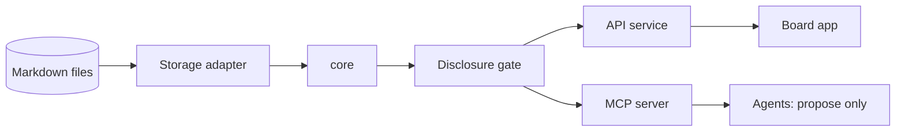

# Reraise

[](https://github.com/Reraise-ai/reraise-app/actions/workflows/ci.yml)
[](LICENSING.md)

> The model is replaceable. Your personal world is not.

_An open project by Caprey SAS · [reraise.ai](https://reraise.ai/)_

## 30-second pitch

Reraise is a local-first tool for building a personal knowledge graph of typed
cards, and for turning it into decisions. Every card shows where it comes from: evidenced,
said, or experience. Your own stance (believed, rejected, undecided) is a private overlay
that never leaves your device. On a board with a guiding question, cards, players and
evidence become a situation; from the situation comes a decision card whose outcome flows
back as experience. AI agents take part as sparring partners through MCP, but they only
propose. A human decides.

## Status

**M1 is done; M2 slices are in progress; the first toolkit release is [v0.2.0](https://github.com/Reraise-ai/reraise-app/releases/tag/v0.2.0).** The board, the Board API, the `markdown-files` adapter and the MCP server work together on the synthetic Hormuz world. The end-to-end test (`pnpm test:e2e`, Playwright) runs in CI on Linux, Windows and macOS and was green at commit `4e0ebf8` (see the [roadmap](docs/roadmap.md)). Six M2 slices (decision card, source profile, rules panel, player fields, time slider, what-if) are built and tested on branches. Version 0.2.0 is tagged and released as `reraise-toolkit-0.2.0.zip`; the M2 slices are not part of it. No feature is claimed here that is not backed by an automated test.

## What and why

Design principles (see ADRs). The first slice of them is implemented and tested (M1, see Status):

- **Files are the truth.** Worlds are Markdown with YAML front matter; any database is derived.
- **Provenance is explicit.** Evidence, hearsay and experience are never mixed.
- **Privacy by design.** A disclosure gate denies by default; cloud models need per-transfer confirmation.
- **Agents propose, humans decide.** Agent moves are proposals until accepted.
- **Open formats.** Card format, schemas and adapters are Apache-2.0; the app is AGPL-3.0-or-later.

## Architecture at a glance



Monorepo layout: `apps/board`, `services/api`, `packages/*`, `schemas/`, `examples/`, `docs/`.
More in the [documentation](docs/index.md): [vision](docs/product/vision.md),
[board UX](docs/product/board-ux.md), [architecture](docs/architecture/index.md),
[card format](docs/reference/card-format.md),
[glossary](docs/glossary.md), [roadmap](docs/roadmap.md) and
[verification](docs/verification.md).
See [LICENSING.md](LICENSING.md) for which licence applies where.

## Quickstart

From a checkout to your own empty board (Node 22, pnpm 10):

```sh
corepack enable
pnpm install
pnpm build
pnpm start --init --store ~/my-world   # creates the store on first start, then just opens it
```

Open the URL it prints and paste the session token from the same line. The service serves the
board itself on `http://127.0.0.1:4310`, so one process and one origin are enough. `--init`
creates `worldbuilder-store.yaml` and one empty, private world ("My world"); on an existing store
it changes nothing.

Without a checkout, with Node 22 only: unpack `reraise-toolkit-<version>.zip` from a GitHub
release (`.github/workflows/release.yml` builds it on a `v*` tag; the first is [v0.2.0](https://github.com/Reraise-ai/reraise-app/releases/tag/v0.2.0)) and run the
same command in that folder: `node services/api/dist/cli.js serve --init --store ~/my-world` (or
`npm start -- --init --store ~/my-world`). Nothing to install: the dependencies are in the zip.
To check a zip the way the release does: `node scripts/smoke-toolkit.mjs <zip>`.
The same folder is the npm package `@reraise/app` (command `reraise`; not published): `npm pack`
in `dist/toolkit` after `node scripts/pack-toolkit.mjs` gives a tarball that runs with
`npx ./reraise-app-<version>.tgz serve --init --store ~/my-world`.

With Docker: `docker compose up --build`, then open `http://127.0.0.1:4310` and paste the token
from `docker compose logs`. Store and state directory live in the volume `reraise-data`
(`/data/world`, `/data/state`); the port is published on loopback only.

In the other docs, `worldbuilder <command>` stands for `node services/api/dist/cli.js <command>`
from a checkout (`pnpm start` is `worldbuilder serve`).

To try the synthetic Hormuz world and connect an agent over MCP:

```sh
cp -r examples/hormuz /tmp/hormuz-store            # work on a copy: the service writes to it
pnpm start --store /tmp/hormuz-store

# in a second terminal: register an agent (the token goes to an owner-only file)
umask 077
node services/api/dist/cli.js agent add planner --target local_model --token-file ./planner.token

# Streamable HTTP: any MCP client with  url http://127.0.0.1:4310/mcp
#                  and header           Authorization: Bearer <contents of planner.token>
# stdio-only clients start the bridge, which forwards to the running service:
WORLDBUILDER_AGENT_TOKEN_FILE=./planner.token node services/api/dist/cli.js mcp --stdio

# board development with hot reload (Vite on :5173) needs the service to allow that origin:
#   pnpm start --store /tmp/hormuz-store --allow-origin http://127.0.0.1:5173
#   pnpm --filter @worldbuilder/board dev

# the end-to-end test: builds, then drives the board with Playwright (Chromium)
# once: pnpm --filter @worldbuilder/e2e exec playwright install chromium
#       (or point PLAYWRIGHT_BROWSERS_PATH to an existing Chromium)
pnpm test:e2e
```

A fresh installation lets the gate show every card on your own screen and to a local model
on this device, including private cards. A cloud model sees nothing until you add an `allow`
rule and confirm each transfer. Stance stays on the screen (see
[Connect a Hermes agent](docs/how-to/connect-hermes-agent.md), which also lists the tools).

To work on the foundations:

```sh
pnpm lint && pnpm typecheck && pnpm test && pnpm build
pnpm docs:dev      # preview the docs site locally
pnpm docs:build    # build it (dead links fail the build)
```

## Repository settings

GitHub secret scanning and push protection must be enabled in the repository settings. CI additionally runs gitleaks over the full history. The CodeQL workflow needs a public repository or GitHub Advanced Security to upload results.

## Links

[Docs](docs/index.md) · [Roadmap](docs/roadmap.md) · [Contributing](CONTRIBUTING.md) · [Code of Conduct](CODE_OF_CONDUCT.md) · [Security](SECURITY.md) ·
[Governance](GOVERNANCE.md) · [Support](SUPPORT.md) · [Changelog](CHANGELOG.md) · [Licensing](LICENSING.md)
