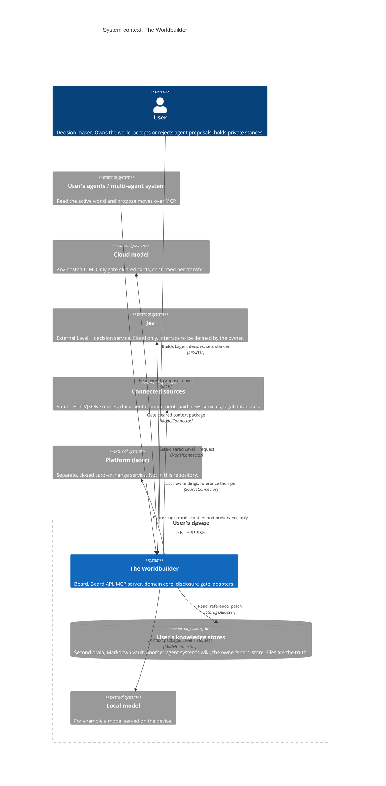

# 3. Context and scope

The Worldbuilder runs on the user's device and sits between the user, the user's own agents,
models and the user's existing knowledge stores. It owns no data of its own except what the
user creates through it (Lagen, decisions, stances), and even that is stored as files in a
store the user controls ([ADR-0006](../adr/0006-files-are-the-truth.md)).

## 3.1 Business context

C4 level 1, system context. Status labels per element are in the table below the diagram.

The diagram draws the knowledge stores on the device for the common case of a local vault.
A store may also be remote (another agent system's wiki, a server-hosted store); its adapter then
reaches it over HTTPS or the store's own interface, as in the
[deployment view](./07-deployment.md#71-default-local-single-user).

| Neighbour | What crosses the boundary | Direction | Status |
| --- | --- | --- | --- |
| User | Lagen, cards placed and edges drawn, accept or reject of proposals, stances, decisions, transfer confirmations | in and out (screen) | planned (M1) for the walking-skeleton steps; M2+ for decisions |
| User's agents (MAS) | MCP tool calls: `world_list`, `lage_get`, `cards_search`, `card_get`, `context_package_get`, `rules_evaluate`, `proposal_create`, `proposal_list`. Responses are gate-filtered for the connection's target class. | in (proposals), out (gate-cleared data) | tool names exist (M0 skeleton); contracts in progress (M0); server planned (M1) |
| User's knowledge stores | Card files read, created and patched through the store's own write path; archived versions | both | reference adapter planned (M1); owner store adapter built outside this repository |
| Connected sources | New findings with provenance (`uri`, connector, `originSystem`, retrieval time); nothing is ingested | in | planned (M2+) |
| Local model | Gate-cleared context packages or Level 1 requests; answers come back as proposals or typed Level 1 results | both | planned (M2+) |
| Cloud model | Same as local model, but only after per-transfer confirmation | both | planned (M2+) |
| Jev | Level 1 request with an output schema and gate-cleared inputs; typed answer with calibrated confidence | both | stub planned (M2+), interface to be defined by the owner |
| Platform | Single shared cards, content and provenance only, never stances; peer-to-peer exchange between users is end-to-end encrypted | out | later ([ADR-0021](../adr/0021-privacy-and-sharing-model.md)) |

Out of scope by decision: ingestion of podcasts and articles
([ADR-0014](../adr/0014-no-ingestion-inbox-of-findings.md)), fine-tuning itself
([ADR-0017](../adr/0017-decision-card-and-training-export.md)), and any economy or exchange
mechanics ([ADR-0021](../adr/0021-privacy-and-sharing-model.md)).

## 3.2 Technical context

| Channel | Protocol and format | Bound to | Notes |
| --- | --- | --- | --- |
| Board app to Board API | HTTP + JSON, OpenAPI 3.1, schemas from `schemas/` | `127.0.0.1` by default | Human session token created at start; CORS only for the board's own origin ([ADR-0026](../adr/0026-security-defaults.md)) |
| Agent to MCP server | MCP over Streamable HTTP at `/mcp` of the local service, or over stdio through the stateless bridge `worldbuilder mcp --stdio` that forwards to it ([ADR-0029](../adr/0029-process-topology.md)) | `127.0.0.1` by default | Bearer token per registered agent connection; the token fixes `agent:<name>` and the disclosure target class ([ADR-0026](../adr/0026-security-defaults.md)) |
| Worldbuilder to knowledge store | `StorageAdapter` (TypeScript interface); the adapter may delegate to the store's own write channel as an external process or service | local file system or the store's own interface | Writes are patches; every write validated and locked by the store's write path ([ADR-0023](../adr/0023-core-domain-model.md)) |
| Worldbuilder to source | `SourceConnector` (read only) | connector-specific (file system, HTTP/JSON) | Results are references with provenance ([ADR-0014](../adr/0014-no-ingestion-inbox-of-findings.md)) |
| Worldbuilder to model or Jev | `ModelConnector` | local endpoint or HTTPS | Called only with gate-cleared canonical objects; provider credentials from environment variables or the OS keychain ([ADR-0026](../adr/0026-security-defaults.md)) |
| Jev | `POST /v1/decide` with caller-defined output schema | HTTPS | Request and response shape provisional until the owner fixes the interface ([ADR-0015](../adr/0015-two-thinking-levels.md)) |

The inbox of findings, the board's view of `SourceConnector` results, is specified as UX in
[Board UX, inbox](../product/board-ux.md#7-inbox-new-findings-from-connected-sources).
