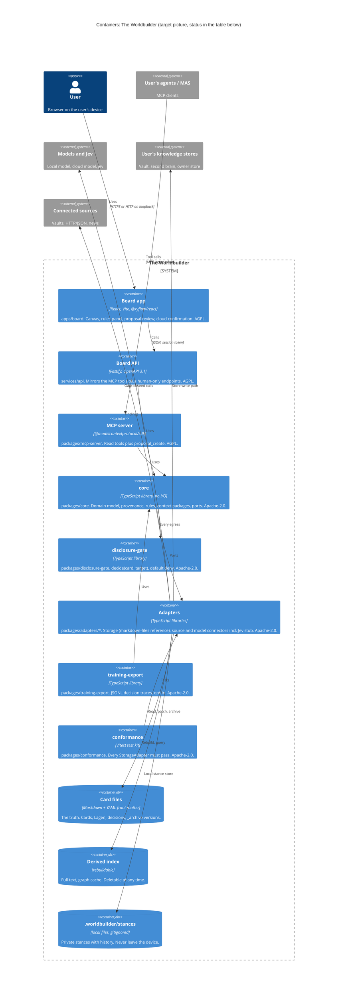
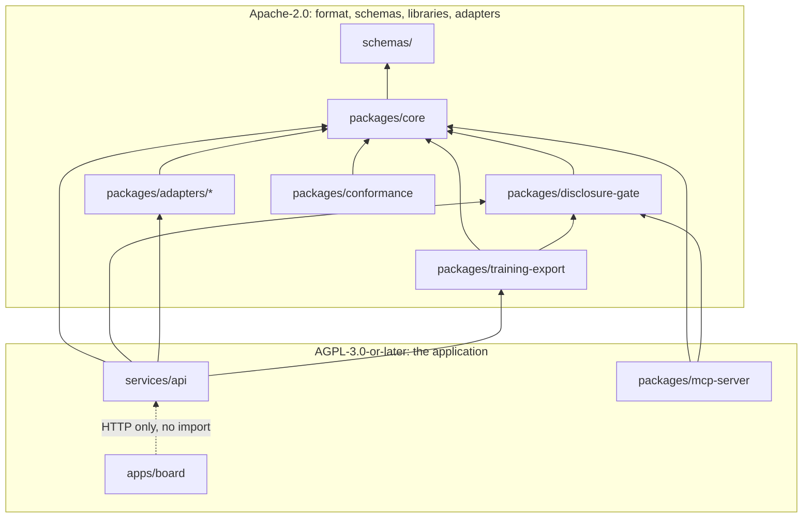

# 5. Building blocks

The repository layout is fixed by [ADR-0003](../adr/0003-typescript-monorepo-stack.md). This
page explains what each part is responsible for, how the parts depend on each other, and what
exists today.

## 5.1 Level 0: the system as a black box

See the [system context](./03-context-scope.md#31-business-context). Inside the box, two
front ends (board app and MCP server) share one domain core. Four ports connect the core to
everything outside: `StorageAdapter`, `SourceConnector`, `ModelConnector` and
`DisclosureGate` ([ADR-0005](../adr/0005-universal-adapter-architecture.md)).

## 5.2 Level 1: container view

C4 level 2. Libraries that run inside another process (core, gate, adapters) are drawn as
containers because they are separately versioned, separately licensed packages with their own
contract. The process boundaries are an open decision, see
[OD-1](./09-decisions.md#92-open-decisions).

| Container | Path | Licence | Exists today | Planned |
| --- | --- | --- | --- | --- |
| Board app | `apps/board` | AGPL-3.0-or-later | exists (M0 skeleton): placeholder page, `tokens.css` with brand defaults | M1: open a Lage, place cards, draw edges, review proposals, context package preview with gate result. M2+: rules panel, decision card, Level 1, inbox, time slider |
| Board API | `services/api` | AGPL-3.0-or-later | exists (M0 skeleton): Fastify app with a `/health` route; binds `127.0.0.1` unless `HOST` is set. OpenAPI contract in progress (M0) | M1: endpoints of the walking skeleton, session token, human-only endpoints |
| MCP server | `packages/mcp-server` | AGPL-3.0-or-later | exists (M0 skeleton): the list of tool names only; no SDK dependency yet. Tool schemas in progress (M0) | M1: read tools and `proposal_create` over stdio and Streamable HTTP |
| core | `packages/core` | Apache-2.0 | exists (M0 skeleton): the `layer` value set. Contract types generated from the schemas and the four port interfaces in progress (M0) | M1: Lage, proposal lifecycle, context package, independence count. M2+: rules evaluation, Level 1 requests, outcome loop, source profiles |
| disclosure-gate | `packages/disclosure-gate` | Apache-2.0 | exists (M0 skeleton): a default-deny function, no rules | M1: rule evaluation per card and target, decision log, blocks a private card for `cloud_model` |
| Storage adapter (reference) | `packages/adapters/storage-markdown-files` | Apache-2.0 | exists (M0 skeleton): adapter id only | M1: reads and patches the reference card format, archive on rewrite, derived index |
| Source and model connectors | `packages/adapters/*` | Apache-2.0 | not started | M2+: local model, cloud model, Jev stub; Obsidian vault, HTTP/JSON, document management, paid news |
| training-export | `packages/training-export` | Apache-2.0 | exists (M0 skeleton): the `training: true` eligibility predicate | M2+: JSONL export behind the gate with per-export confirmation |
| conformance | `packages/conformance` | Apache-2.0 | exists (M0 skeleton): version constant. Kit skeleton with mapping-rule tests against an in-memory fake in progress (M0) | M1: full kit run against the reference adapter |
| Card files | user-chosen folder | user data | none (the synthetic example worlds are in progress, M0) | M1 |
| Derived index | next to the files, per adapter | derived | none | M1 |
| `.worldbuilder/stances` | user's device | private | none (path excluded by `.gitignore`) | M1 |

`schemas/` (JSON Schema and `openapi/`) and `examples/` are contracts and data, not
containers. They are in progress (M0) and not yet on the trunk.

## 5.3 Responsibilities

Each building block, its single responsibility and its interfaces.

| Building block | Responsible for | Not responsible for |
| --- | --- | --- |
| Board app | Presenting a Lage as a canvas with custom nodes; collecting human actions (place, move, draw, accept, reject, confirm transfer, set stance); showing gate decisions and proposal authors. Styled only through design tokens ([ADR-0019](../adr/0019-design-tokens-and-board-canvas.md)) | Any domain rule; any direct store access. The board is only a client of the Board API (AC-23) |
| Board API | Authenticating the human session; exposing the MCP-mirroring endpoints and the human-only endpoints (proposal accept and reject, Lage save, decision save, disclosure confirm, [ADR-0016](../adr/0016-mcp-first-and-openapi-contracts.md)), plus stance writes, which [ADR-0008](../adr/0008-believed-as-private-stance.md) reserves to humans; schema-validating input with size limits ([ADR-0026](../adr/0026-security-defaults.md)) | Domain logic beyond orchestration |
| MCP server | Authenticating agent connections and mapping each to `agent:<name>` and a target class; exposing the eight tools; setting a proposal's `author` from the connection, never from the payload ([ADR-0011](../adr/0011-agent-moves-are-proposals.md)) | Any write other than `proposal_create`; any stance access |
| core | Canonical domain model (types generated from or tested against the JSON Schemas); provenance rules and the independence count ([ADR-0009](../adr/0009-mandatory-provenance.md)); proposal lifecycle and the non-counting rule; context package assembly; rules evaluation without any score ([ADR-0013](../adr/0013-rules-panel-replaces-barometer.md)); Level 1 request and result shapes ([ADR-0015](../adr/0015-two-thinking-levels.md)); source profile derivation ([ADR-0018](../adr/0018-multidimensional-source-profile.md)); the four port interfaces | Any I/O, network, file system or clock access other than through ports |
| disclosure-gate | `decide(card, target) → {decision, reason}` for `screen`, `local_model`, `cloud_model`, `demo`; default deny; stance data only for `screen`; per-transfer confirmation requirement for `cloud_model`; local decision log without card content ([ADR-0012](../adr/0012-disclosure-gate.md)) | Choosing which cards are relevant; the confirmation UI |
| Local stance and proposal store | Persisting stances (with history) and proposals on the user's device, outside every shared or remote store. Which package owns it is open ([OD-2](./09-decisions.md#92-open-decisions)) | Card data |
| Storage adapter | Mapping one store to the canonical model ([ADR-0023](../adr/0023-core-domain-model.md)); derived ids; patch writes through the store's own write path with lock and optimistic concurrency; archive on rewrite; rebuilding its derived index; reporting capabilities | Deciding what may leave the device; stances (never written to card files, [ADR-0008](../adr/0008-believed-as-private-stance.md)) |
| Source connector | Listing new findings as references with provenance | Writing anything; deciding relevance |
| Model connector | Sending gate-cleared canonical objects to one model or Jev and returning the answer as a proposal or a typed Level 1 result | Calling without a gate decision; persisting answers as facts |
| training-export | Writing decision traces as JSONL for decisions and cards with `training: true` only ([ADR-0017](../adr/0017-decision-card-and-training-export.md)) | Fine-tuning |
| conformance | Contract shape, round trip, provenance rules, archive on rewrite, index rebuild, id derivation, patch byte-identity and the legacy mapping rules ([ADR-0005](../adr/0005-universal-adapter-architecture.md), [ADR-0023](../adr/0023-core-domain-model.md), [ADR-0027](../adr/0027-card-format-mapping-addenda.md)) | Testing a specific store's own validator |

## 5.4 Package dependencies and licence tiers

Dependencies point towards `core`, never away from it, and an Apache-2.0 package never
imports an AGPL package ([ADR-0003](../adr/0003-typescript-monorepo-stack.md),
[ADR-0004](../adr/0004-two-tier-licensing.md)). This is the intended graph; the automated
check for the licence rule is not written yet (ADR-C07 in
[verification](../verification.md#checks-promised-by-the-adrs)).

An arrow means "depends on". The board app talks to the Board API over HTTP and imports no
server package; it may import generated contract types from `core`.

## 5.5 Level 2: inside core (planned)

`core` is where the product's rules live. Planned modules, none implemented yet:

| Module | Content | Milestone |
| --- | --- | --- |
| Contract types | Card, Edge, World, Lage, Stance, Proposal, Decision, Rule, SourceProfile, ContextPackage, Level 1 result; generated from the JSON Schemas | M0 (in progress) |
| Ports | `StorageAdapter`, `SourceConnector`, `ModelConnector`, `DisclosureGate` interfaces | M0 (in progress) |
| Provenance | Provenance rules per layer, the independence count over `cites` and `based_on` edges and source identity | M1 |
| Proposals | Lifecycle from `pending` to `accepted` or `rejected`, the non-counting rule | M1 |
| Context package | Selection from request, active world, cards, relations, decisions and provenance; per-card gate decision; pending proposals in a separate section | M1 |
| Rules | `rules_evaluate(lage)`: fired or not fired, triggering card ids, `withheld: n` for non-screen targets | M2+ |
| Level 1 | Request building (options enum, inputs) and result validation | M2+ |
| Outcome loop and source profile | Hit statistics, profile dimensions with sample sizes | M2+ |
