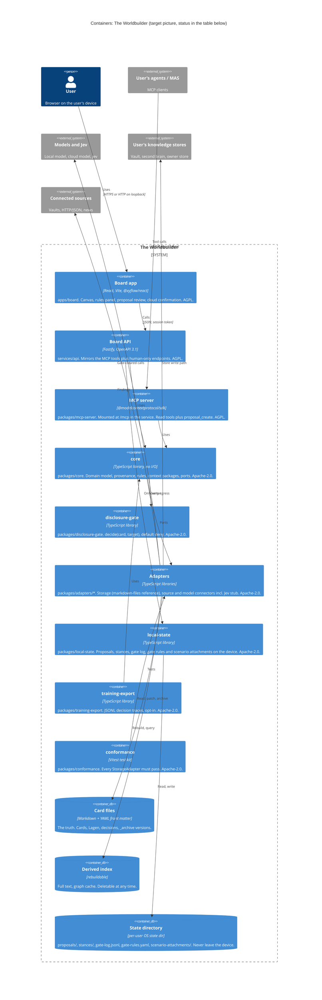
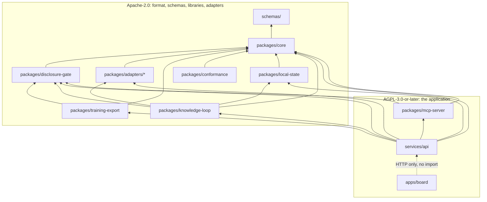

# 5. Building blocks

The repository layout is fixed by [ADR-0003](../adr/0003-typescript-monorepo-stack.md). This
page explains what each part is responsible for, how the parts depend on each other, and what
exists today.

## 5.1 Level 0: the system as a black box

See the [system context](./03-context-scope.md#31-business-context). Inside the box, two
front ends (board app and MCP server) share one domain core. Four ports connect the core to
everything outside: `StorageAdapter`, `SourceConnector`, `ModelConnector`, `Level1Engine` and
`DisclosureGate` ([ADR-0005](../adr/0005-universal-adapter-architecture.md)). Device-only state
(proposals, stances, gate log, gate rules) sits behind a fifth, local-state interface
([ADR-0030](../adr/0030-local-state-on-the-device.md)).

## 5.2 Level 1: container view

C4 level 2. Libraries that run inside another process (core, gate, adapters) are drawn as
containers because they are separately versioned, separately licensed packages with their own
contract. Process layout: one local service process hosts the Board API and the MCP server
(Streamable HTTP at `/mcp`); stdio-only MCP clients use the stateless bridge
`worldbuilder mcp --stdio`, which forwards to that service and never writes
([ADR-0029](../adr/0029-process-topology.md)).

| Container | Path | Licence | Exists today | Planned |
| --- | --- | --- | --- | --- |
| Board app | `apps/board` | AGPL-3.0-or-later | exists: client of the Board API. The context package lists findings and origins per layer and shows no merged card total (AC-01). A card shows its stored content type on the canvas, in the card list and in the inspector, including `assumption` (a premise) and `rating` (an own assessment) (AC-04). The same three places show `originSystem` when the store recorded one, and show no system line when it did not (AC-06). Removing a placed card drops it, and the edges that used it, from the Lage. The card file stays. The next context package is built from the cards still placed (AC-22). Creating a Lage stores the user's question and any number of options, including none, and the open board shows them (AC-07). The user draws, reverses and deletes `supports` and `refutes` edges, and a restart of `worldbuilder serve` keeps the reversed edge and does not restore the deleted one (AC-08). The open board records a decision and, once the outcome is known, shows the experience card the service stored. The open board lists which rules fire and which do not, with the triggering cards, and shows no percentage (AC-03). The user creates a rule card and changes its action; the next evaluation reads the stored card (AC-10). A placed card with one known origin is marked "One source"; the same statement from two independent origins is marked "Journalistic standard" (Entscheidung 125). The inspector shows the eight source-profile dimensions, each with its sample size, and "insufficient data" below n of 5 (ADR-0018). A placed card, an actor's seat entries and moves, each edge, and the cards a decision uses show a source pass, "N findings · M origins" (AC-30). When a Lage has an archived version, the board shows that earlier board and does not save the view (ADR-0049). The what-if layer holds assumptions that are not cards. Recording a decision can attach them. The card files stay as they were (ADR-0050) | M1: open a Lage, place cards, review proposals, context package preview with gate result. M2+: rules panel, decision card, Level 1, inbox |
| Board API | `services/api` | AGPL-3.0-or-later | exists (M0 skeleton): Fastify app with a `/health` route; binds `127.0.0.1` unless `HOST` is set. OpenAPI contract in progress (M0). `lage_create` writes a Lage card through the storage adapter. A later process reads the question and the options back (AC-07). Saving a known outcome writes one private experience card with `based_on` edges to the decision and to `cardsUsed`. The eleven sections survive a restart (AC-09). A known outcome adds one to the hit count of each source cited by `cardsUsed`. The previous profile stays in the state directory and is not written into the card store (AC-11). `rule_create` and `rule_save` write a rule card through the storage adapter. A restart still evaluates the changed action (AC-10). `scenario_replace` keeps assumptions in memory and writes no card. `scenario_attach` copies them onto a decision in the state directory and leaves the decision card unchanged (ADR-0050). | M1: endpoints of the walking skeleton, session token, human-only endpoints; the `worldbuilder` command (service start and the `mcp --stdio` bridge) as the package binary ([ADR-0029](../adr/0029-process-topology.md)) |
| MCP server | `packages/mcp-server` | AGPL-3.0-or-later | implemented (M1): the thirteen agent tools of `tools.ts` on the official MCP SDK with self-contained schemas bundled from the contracts, per-agent sessions over Streamable HTTP, and the stdio bridge; the service mounts it at `/mcp` and every tool runs the operation code of the HTTP route of the same name ([ADR-0029](../adr/0029-process-topology.md)) | live notifications (proposals, Lage changes) over the same connection |
| core | `packages/core` | Apache-2.0 | exists: the `layer` value set, contract types, port interfaces, origin-root counting (`originRoots`, `independenceOf`, AC-29), and `createLocalQuoteModel` (`local-quote`), which names only the card ids it was given and writes no proposals (AC-16). `cardsForPackage` drops edges, Lage placements and `cardsUsed` ids that are not in the same package, and leaves out a rule that states a stance or names a card outside the package, for every target except the screen (AC-18). `deriveSourceProfiles` counts one `hitAccuracy` sample per known outcome per cited source; the other dimensions stay at n = 0 (ADR-0018) | M1: Lage, proposal lifecycle, context package selection beyond the gate. M2+: rules evaluation, outcome loop, source profiles |
| disclosure-gate | `packages/disclosure-gate` | Apache-2.0 | exists: default deny, deny wins, stance data only for `screen`. The file `worldbuilder serve` writes on first start allows every card for `screen` and `local_model`, including private cards; `cloud_model` and `demo` stay deny (ADR-0031) | blocks a private card for `cloud_model` unless an allow rule clears it and the user confirms that transfer |
| Storage adapter (reference) | `packages/adapters/storage-markdown-files` | Apache-2.0 | exists (M0 skeleton): adapter id only | M1: reads and patches the reference card format, archive on rewrite, derived index |
| Source and model connectors | `packages/adapters/*` | Apache-2.0 | M1 stand-in only: `createLocalQuoteModel` in `packages/core` answers with card ids, no network and no proposals (AC-16). No connector package yet | M2+: local model, cloud model, Jev stub; Obsidian vault, HTTP/JSON, document management, paid news |
| local-state | `packages/local-state` | Apache-2.0 | M1: implemented (store, state-directory resolution and safety check, gate log, rules loader). The service writes a stance there and reads it back after a restart (AC-05). A source profile is `source-profiles/<sha256>.json` (AC-11). A scenario attachment is `scenario-attachments/<decisionId>.json` (ADR-0050) | M1: proposals, stances, gate log and gate rules in the per-user state directory behind a core interface ([ADR-0030](../adr/0030-local-state-on-the-device.md)) |
| training-export | `packages/training-export` | Apache-2.0 | exists (M0 skeleton): the `training: true` eligibility predicate | M2+: JSONL export behind the gate with per-export confirmation |
| conformance | `packages/conformance` | Apache-2.0 | exists (M0 skeleton): version constant. Kit skeleton with mapping-rule tests against an in-memory fake in progress (M0) | M1: full kit run against the reference adapter |
| Card files | user-chosen folder | user data | none (the synthetic example worlds are in progress, M0) | M1 |
| Derived index | in memory, per adapter | derived | none | M1: rebuilt at start, file-watcher refresh ([ADR-0033](../adr/0033-derived-index-reference-adapter.md)) |
| State directory | per-user OS state directory (or a configured path), never inside a store root or Git working tree | private | exists: `stances/<cardId>.json` survives a service restart and is not copied into the card store (AC-05). `source-profiles/<sha256>.json` holds the derived profile and the earlier ones. `scenario-attachments/<decisionId>.json` holds the assumptions attached to a decision and is not written into the decision card (ADR-0050) | M1: `proposals/<ulid>.json`, `stances/`, `source-profiles/`, `gate-log.jsonl`, `gate-rules.yaml` ([ADR-0030](../adr/0030-local-state-on-the-device.md)) |

`schemas/` (JSON Schema and `openapi/`) and `examples/` are contracts and data, not
containers. They are in progress (M0) and not yet on the trunk.

## 5.3 Responsibilities

Each building block, its single responsibility and its interfaces.

| Building block | Responsible for | Not responsible for |
| --- | --- | --- |
| Board app | Presenting a Lage as a canvas with custom nodes; collecting human actions (place, move, draw, accept, reject, confirm transfer, set stance); showing gate decisions and proposal authors. Styled only through design tokens ([ADR-0019](../adr/0019-design-tokens-and-board-canvas.md)) | Any domain rule; any direct store access. The board is only a client of the Board API (AC-23) |
| Board API | Authenticating the human session; exposing the MCP-mirroring endpoints and the human-only endpoints (proposal accept and reject, Lage save, decision save, disclosure confirm, [ADR-0016](../adr/0016-mcp-first-and-openapi-contracts.md)), plus the human-only stance endpoint `PUT /cards/{id}/stance` ([ADR-0030](../adr/0030-local-state-on-the-device.md)) and the HTTP mirror of `proposal_list` with `changedSince`, which the M1 board polls ([ADR-0032](../adr/0032-m1-proposal-polling.md)); the only writer of local state; schema-validating input with size limits ([ADR-0026](../adr/0026-security-defaults.md)) | Domain logic beyond orchestration |
| MCP server | Running inside the service at `/mcp`, reached by stdio clients through the stateless bridge of `services/api` ([ADR-0029](../adr/0029-process-topology.md)); validating `Origin` and `Host`; authenticating agent connections and mapping each to `agent:<name>` and a target class; exposing the eight tools of ADR-0016 and the five knowledge-loop tools ([ADR-0039](../adr/0039-knowledge-loop-receipts.md)); setting a proposal's `author` and a receipt's `agent` from the connection, never from the payload ([ADR-0011](../adr/0011-agent-moves-are-proposals.md)) | Any write other than creating a proposal; any stance access |
| core | Canonical domain model (types generated from or tested against the JSON Schemas); provenance rules and the independence count ([ADR-0009](../adr/0009-mandatory-provenance.md)); proposal lifecycle and the non-counting rule; context package assembly; rules evaluation without any score ([ADR-0013](../adr/0013-rules-panel-replaces-barometer.md)); Level 1 request and prediction shapes ([ADR-0035](../adr/0035-level1-engine-socket.md)); source profile derivation ([ADR-0018](../adr/0018-multidimensional-source-profile.md)); the port interfaces | Any I/O, network, file system or clock access other than through ports |
| disclosure-gate | `decide(card, target) → {decision, reason}` for `screen`, `local_model`, `cloud_model`, `demo`; default deny; stance data only for `screen`; declarative allow and deny rules, deny wins; per-transfer confirmation for `cloud_model` bound to the hash of the exact payload; local decision log without card content ([ADR-0012](../adr/0012-disclosure-gate.md), [ADR-0031](../adr/0031-gate-rules-and-confirmation-binding.md)) | Choosing which cards are relevant; the confirmation UI |
| local-state | Persisting proposals, stances (with history), the gate log and gate rules in the per-user state directory on the user's device, outside every shared or remote store ([ADR-0030](../adr/0030-local-state-on-the-device.md)) | Card data; deciding anything |
| Storage adapter | Mapping one store to the canonical model ([ADR-0023](../adr/0023-core-domain-model.md)); derived ids; patch writes through the store's own write path with lock and optimistic concurrency; archive on rewrite; rebuilding its derived index (in memory for the reference adapter, [ADR-0033](../adr/0033-derived-index-reference-adapter.md)); reporting capabilities | Deciding what may leave the device; stances (never written to card files, [ADR-0008](../adr/0008-believed-as-private-stance.md)) |
| Source connector | Listing new findings as references with provenance | Writing anything; deciding relevance |
| Model connector | Sending gate-cleared canonical objects to one model or Jev and returning the answer as a proposal or a typed Level 1 result | Calling without a gate decision; persisting answers as facts |
| training-export | Writing decision traces as JSONL for decisions and cards with `training: true` only, for decisions with a known outcome ([ADR-0017](../adr/0017-decision-card-and-training-export.md), [ADR-0039](../adr/0039-knowledge-loop-receipts.md)) | Fine-tuning |
| knowledge-loop | Knowledge and Write-back Receipts; the hash-chained receipt log and the fail-closed verifier ([ADR-0040](../adr/0040-receipt-log-and-verifier.md)); usage metrics ([ADR-0041](../adr/0041-usage-ledger-and-metrics.md)); memory routing rules ([ADR-0042](../adr/0042-memory-route-classification.md)); the atlas digest ([ADR-0043](../adr/0043-digest-atlas-regeneration.md)); the offline `wb` command line | Serving tools or endpoints (the service wires it); writing cards or proposals |
| conformance | Contract shape, round trip, provenance rules, archive on rewrite, index rebuild, id derivation, patch byte-identity and the legacy mapping rules ([ADR-0005](../adr/0005-universal-adapter-architecture.md), [ADR-0023](../adr/0023-core-domain-model.md), [ADR-0027](../adr/0027-card-format-mapping-addenda.md)) | Testing a specific store's own validator |

## 5.4 Package dependencies and licence tiers

Dependencies point towards `core`, never away from it, and an Apache-2.0 package never
imports an AGPL package ([ADR-0003](../adr/0003-typescript-monorepo-stack.md),
[ADR-0004](../adr/0004-two-tier-licensing.md)). This is the intended graph; the automated
check for the licence rule is not written yet (ADR-C07 in
[verification](../verification.md#checks-promised-by-the-adrs)).

An arrow means "depends on". `services/api` depends on `packages/mcp-server` because the
service mounts the MCP server at `/mcp` ([ADR-0029](../adr/0029-process-topology.md)). The board app talks to the Board API over HTTP and imports no
server package; it may import generated contract types from `core`.

## 5.5 Level 2: inside core

`core` is where the product's rules live. Provenance counting exists. The other rows are the planned scope of that module.

| Module | Content | Milestone |
| --- | --- | --- |
| Contract types | Card, Edge, World, Lage, Stance, Proposal, Decision, Rule, SourceProfile, ContextPackage, Level 1 prediction; generated from the JSON Schemas | M0 (in progress) |
| Ports | `StorageAdapter`, `SourceConnector`, `ModelConnector`, `Level1Engine`, `DisclosureGate` interfaces (M0, in progress), plus the local-state interface of [ADR-0030](../adr/0030-local-state-on-the-device.md) (M1) | M0 / M1 |
| Provenance | `originRoots` and `independenceOf` in `packages/core/src/independence.ts`. Distinct origin roots over `cites` and `based_on`, the same `contentHash` and the same source URI. Never typed in (AC-29) | exists |
| Proposals | Lifecycle from `pending` to `accepted` or `rejected`, the non-counting rule | M1 |
| Context package | For a target other than the screen, edges, Lage placements and `cardsUsed` name only cards in the package (`cardsForPackage`, AC-18). A rule card with a stance condition, or a condition that names a card outside the package, is left out and only counted. Provenance counts and pending proposals are on the package. The card set is still every gate-cleared card in the world or on the Lage | M1 remainder: the service does not call the model. A confirmed cloud transfer sends the stored cards |
| Rules | `rules_evaluate(lage)`: fired or not fired, triggering card ids, `withheld: n` for non-screen targets | M2+ |
| Level 1 | Request building (players, move options, gate-cleared cards), prediction validation, staleness by request hash ([ADR-0035](../adr/0035-level1-engine-socket.md), [ADR-0045](../adr/0045-level1-service-seam.md)); service operations, engine registry and board panel | done (local engine, service, board; cloud engines tested against a fake service) |
| Outcome loop and source profile | `deriveSourceProfiles`: `hitAccuracy.n` counts known outcomes that cited the source. The board shows each dimension and its `n`, and "insufficient data" below `minimumN` (5). The other seven dimensions stay at n = 0 until their inputs exist (ADR-0018, OQ-31) | in progress |
