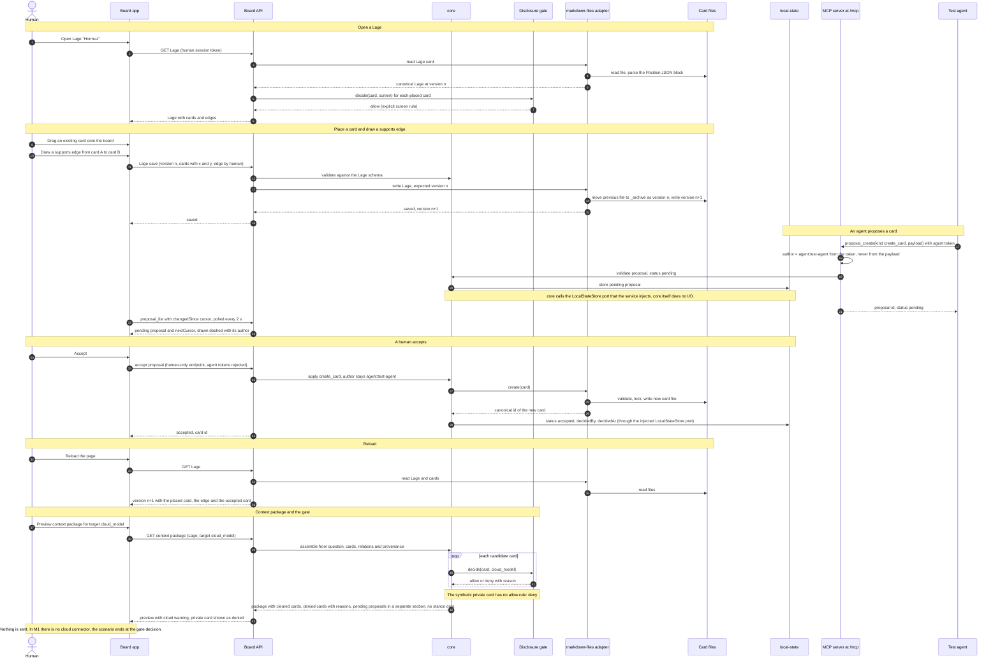
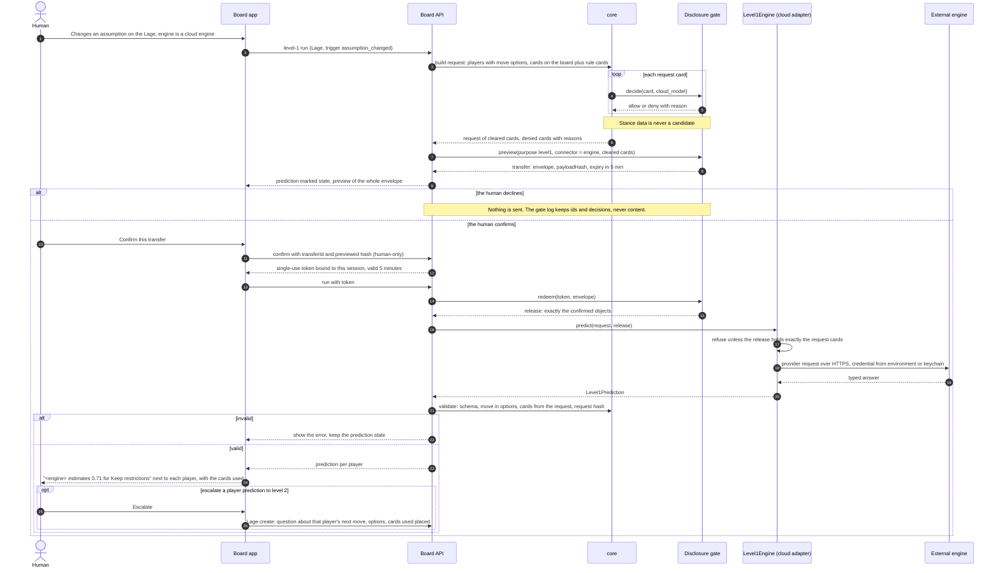
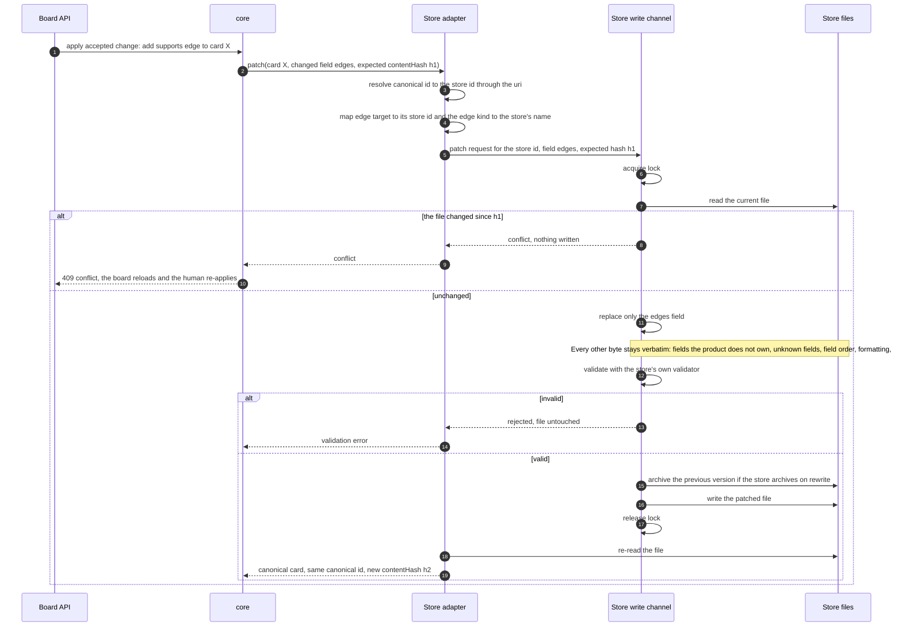

# 6. Runtime view

Three scenarios show how the building blocks of [section 5](./05-building-blocks.md)
cooperate. **None of them runs today.** Scenario 6.1 is the target of milestone M1, 6.2 and
6.3 belong to M2+ slices and to adapters outside this repository. Endpoint and message names
are descriptive; the normative names are in the OpenAPI contract and the MCP tool definitions
(in progress, M0). The process layout follows [ADR-0029](../adr/0029-process-topology.md):
the Board API and the MCP server run in one local service process.

## 6.1 M1 walking skeleton

Status: planned (M1). This is the Hormuz scenario of the
[roadmap](../roadmap.md#m1-walking-skeleton); one Playwright test will run it end to end in CI
(M1-01 in [verification](../verification.md#m1-walking-skeleton)). All data is synthetic.

Points the end-to-end test asserts:

- The Lage, the placed card, the edge and the accepted card survive a reload because they are
  in the files, and the previous Lage version is in `_archive/`
  ([ADR-0006](../adr/0006-files-are-the-truth.md)).
- The accepted card keeps `author: agent:test-agent`; before acceptance it counted nowhere
  ([ADR-0011](../adr/0011-agent-moves-are-proposals.md)).
- The private card is denied for `cloud_model` and shown as denied, not silently dropped
  ([ADR-0012](../adr/0012-disclosure-gate.md)).

## 6.2 Level 1 prediction through a cloud engine

Status: planned (level-1 slice right after M1). Level 1 is the `Level1Engine` socket
([ADR-0035](../adr/0035-level1-engine-socket.md)): per player on the Lage, the engine predicts
the next move out of a closed set of move options, from the cards on the board and the user's
rule cards. The default engine is local (`local_model`, no confirmation, automatic what-if
re-runs). The flow below is the cloud case, for example the Jev adapter, whose wire format
stays inside the adapter: every run is `cloud_model` egress with per-transfer confirmation.

Any change after the preview (a card, the engine, the players, the move options) changes the
envelope hash and the request hash; the confirmation fails and the prediction stays stale until
the user confirms a new transfer ([ADR-0031](../adr/0031-gate-rules-and-confirmation-binding.md)).
A prediction is not a card, not a decision, triggers no rule, enters no statistics and is never
shared ([ADR-0036](../adr/0036-conclusions-are-private.md)). With a local engine the same flow
has no preview, confirmation or release; it runs on every trigger and shows the latest
prediction whose request hash is current.

## 6.3 Write-back patch to an external store

Status: planned. The reference `markdown-files` adapter implements this flow inside the
adapter (M1). A store with its own write channel, such as the owner's card store, has an
adapter that delegates to that channel; that adapter is built and operated outside this
repository against the same conformance kit
([ADR-0005](../adr/0005-universal-adapter-architecture.md)).

The trigger is any accepted change to a card that lives in an external store, here a human
accepting an `add_edge` proposal on card X.

Why this matters:

- **Foreign fields survive.** A store may hold fields the product does not model, or models
  elsewhere: an own-assessment field becomes a private stance note on read
  ([ADR-0008](../adr/0008-believed-as-private-stance.md)), but stays verbatim in the file.
  The conformance kit proves that a patch changes only the patched field
  ([ADR-0023](../adr/0023-core-domain-model.md)).
- **Ids stay stable.** The canonical id is derived from the URI, so it is the same after the
  write, after an index rebuild and on another machine.
- **Egress is canonical.** What later leaves the device is the canonical object after a gate
  decision, never the raw file, so foreign fields cannot leak through egress
  ([ADR-0012](../adr/0012-disclosure-gate.md)).

## 6.4 Failure behaviour across scenarios

| Situation | Behaviour | Source |
| --- | --- | --- |
| No gate rule matches | Deny, with a reason, for every target | [ADR-0012](../adr/0012-disclosure-gate.md) |
| Unregistered MCP connection or missing token | Rejected; nothing is read | [ADR-0012](../adr/0012-disclosure-gate.md), [ADR-0026](../adr/0026-security-defaults.md) |
| Agent token on a human-only endpoint | Rejected | [ADR-0026](../adr/0026-security-defaults.md) |
| Schema-invalid or oversized input | Rejected and logged without card content | [ADR-0026](../adr/0026-security-defaults.md) |
| Concurrent writes to the same card or Lage | Optimistic concurrency on `version` or `contentHash`; the loser gets a conflict and nothing is written | [ADR-0006](../adr/0006-files-are-the-truth.md) |
| Derived index missing or corrupt | Deleted and rebuilt from the files | [ADR-0006](../adr/0006-files-are-the-truth.md) |
| Model or level-1 engine unavailable | The request fails visibly; no proposal, no fallback to another target without a new gate decision | [ADR-0012](../adr/0012-disclosure-gate.md), [ADR-0035](../adr/0035-level1-engine-socket.md) |
