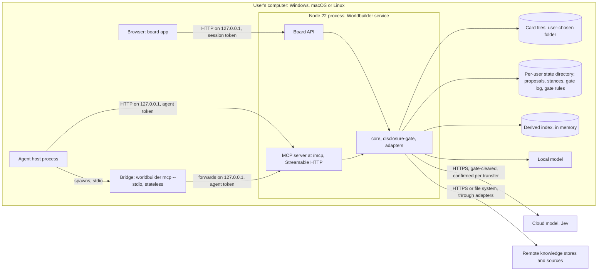

# 7. Deployment view

Status: nothing is deployable yet. There is no quickstart before M1 (see the
[README](https://github.com/Reraise-ai/reraise-app#quickstart)). This page fixes the
target deployment the M1 implementation must meet.

## 7.1 Default: local, single user

The default installation runs entirely on the user's computer. Nothing is reachable from the
network ([ADR-0026](../adr/0026-security-defaults.md)).

| Node | Runs | Status |
| --- | --- | --- |
| Browser | The board app, served to `localhost` | planned (M1) |
| Worldbuilder service | Board API and the MCP server (Streamable HTTP at `/mcp`) in one process with the libraries, one write path per store, bound to `127.0.0.1` ([ADR-0029](../adr/0029-process-topology.md)) | planned (M1). Today `services/api` binds `127.0.0.1` unless `HOST` is set (M0 skeleton) |
| stdio bridge | `worldbuilder mcp --stdio` (binary of `services/api`), started by the agent host; reads its agent token from an environment variable or a token file, never from the command line; forwards to `/mcp` including `Mcp-Session-Id` and server-initiated streams; holds no state, never writes files, fails if the service is not running ([ADR-0029](../adr/0029-process-topology.md)) | implemented (M1); tested, not yet run in CI |
| Card files | Markdown files in a folder the user chooses; the user's own store or a synthetic example world | planned (M1) |
| Per-user state directory | Local, private state: `proposals/<ulid>.json`, `stances/`, the append-only `gate-log.jsonl` (ids, targets, decisions, never content) and `gate-rules.yaml`. Default `$XDG_STATE_HOME/worldbuilder` on Linux, `%LOCALAPPDATA%\Worldbuilder` on Windows, `~/Library/Application Support/Worldbuilder` on macOS, or an explicitly configured path. The service refuses to start if it resolves inside a configured store root or a Git working tree. Written only by the service through `packages/local-state` | planned (M1) ([ADR-0030](../adr/0030-local-state-on-the-device.md)) |
| Derived index | In memory in the service, rebuilt by scanning the files at start and refreshed by a file watcher with rescan fallback; SQLite only on measured need | planned (M1) ([ADR-0033](../adr/0033-derived-index-reference-adapter.md)) |
| Local model | Any model served on the device, reached through a `ModelConnector` | planned (M2+) |
| Cloud model, Jev | Outside the device, reached over HTTPS only with gate-cleared, confirmed transfers | planned (M2+) |

Provider credentials come from environment variables or the operating-system keychain, never
from card files, exports or logs ([ADR-0026](../adr/0026-security-defaults.md)).

## 7.2 Self-hosted (deliberate widening)

A user may run the service on their own server instead of their laptop. This requires an
explicit bind configuration and is documented as "put your own access control (VPN, reverse
proxy with authentication) in front" ([ADR-0026](../adr/0026-security-defaults.md)). There is
no multi-user model; one service serves one user.

Consequence for privacy: "the device" is then the machine the service runs on. Stances and
the gate log live there. The documentation for self-hosting must say so (see
[risks](./11-risks-debt.md#111-risks)).

## 7.3 Portability: Windows, macOS and Linux

The release gate is M1 passing on all three operating systems in CI
([ADR-0020](../adr/0020-build-order-milestones.md)). Known portability concerns the
implementation must handle:

| Concern | Rule |
| --- | --- |
| Paths | Build paths with `node:path`; never assume `/` as separator or a POSIX home layout. Store URIs never contain paths ([ADR-0023](../adr/0023-core-domain-model.md)). |
| Line endings | Files are read with either line ending; patches keep the file's existing line ending so that untouched bytes stay identical. `.gitattributes` normalises the repository itself. |
| Unicode file names | macOS may report decomposed file names. Store ids are NFC-normalised before deriving URIs and ids ([ADR-0023](../adr/0023-core-domain-model.md)). |
| Case-insensitive file systems | Windows and macOS defaults ignore case. Store ids are case preserving, so two ids that differ only in case must not map to two files in one folder. The reference adapter must detect and reject such a collision. |
| File locks | Locking semantics differ by OS. The write path uses a lock file plus optimistic concurrency on `version` / `contentHash`, which does not rely on OS-specific mandatory locks ([ADR-0006](../adr/0006-files-are-the-truth.md)). |
| Credentials | OS keychain access differs per platform; environment variables are the portable fallback ([ADR-0026](../adr/0026-security-defaults.md)). |

The CI workflow already contains a test matrix over `ubuntu-latest`, `windows-latest` and
`macos-latest`, but it has never run on GitHub (see
[risks](./11-risks-debt.md#112-technical-debt)).

## 7.4 Repository delivery

| Artefact | Built by | Delivered to | Status |
| --- | --- | --- | --- |
| Packages and app | `pnpm build` | not published | M0 skeleton builds locally |
| Documentation site | `pnpm docs:build` (VitePress) | GitHub Pages, from `main` only | workflow exists, never run on GitHub |
| Release `v0.1.0` | release workflow | GitHub release with notes | planned, only when M1 passes on three OS |
| Packaged installers | not decided | – | later; Node is a runtime dependency until then ([ADR-0003](../adr/0003-typescript-monorepo-stack.md)) |
