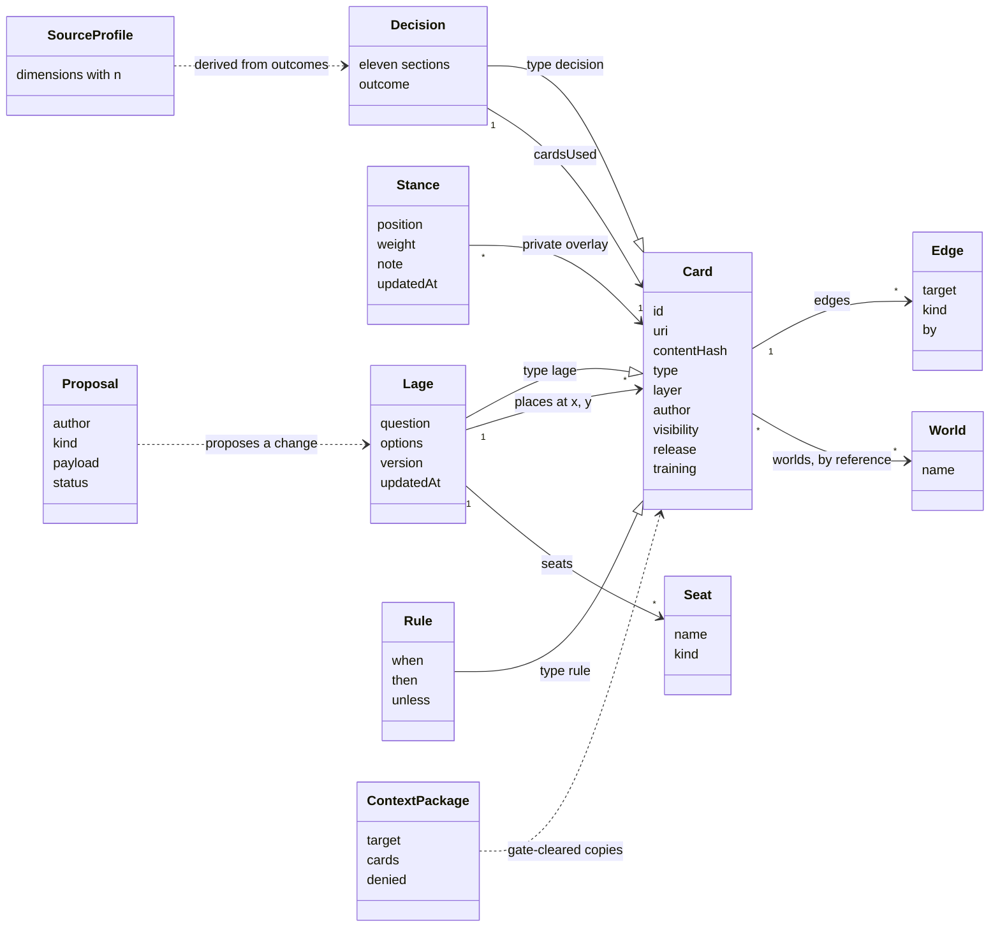

# 8. Crosscutting concepts

Concepts that apply to several building blocks. Field-level definitions live in the
[card format reference](../reference/card-format.md) and in the JSON Schemas (in progress, M0);
this page only shows how the concepts hang together.

## 8.1 Domain model

The canonical model is English and minimal, with an explicit named field for every field of
card format v2 ([ADR-0023](../adr/0023-core-domain-model.md)). Main objects and their
relations:

| Concept | Rule that shapes the architecture | ADR |
| --- | --- | --- |
| Layer | `layer ∈ {evidenced, said, experience}`, never merged into one figure. `level` is reserved for card tiers | [0007](../adr/0007-epistemic-layer-field.md) |
| Stance | "Believed" is a per-user overlay (`believed`, `rejected`, `undecided`, weight, note, history), stored outside card files, set only by humans | [0008](../adr/0008-believed-as-private-stance.md) |
| Lage | A card of type `lage` whose state is a JSON block in a `## Position` section; rewrites archive the previous version | [0006](../adr/0006-files-are-the-truth.md), [0027](../adr/0027-card-format-mapping-addenda.md) |
| Decision | Exactly eleven sections; `cardsUsed` ids must exist; `outcome` is `open` until known | [0017](../adr/0017-decision-card-and-training-export.md) |
| Rule | A user-authored card; evaluation returns fired or not fired, never a score | [0013](../adr/0013-rules-panel-replaces-barometer.md) |
| Proposal | Separate object, not a card status; the only agent write path | [0011](../adr/0011-agent-moves-are-proposals.md) |
| Source profile | Separate dimensions, each with a sample size, derived and rebuildable | [0018](../adr/0018-multidimensional-source-profile.md) |
| Estimates | ICD 203 bands; the original phrase and the band are both stored | [0010](../adr/0010-estimative-probability-scale.md) |
| Reserved | `level`, `signature`; nothing is built on them | [0021](../adr/0021-privacy-and-sharing-model.md) |

## 8.2 Provenance and independence

- Every format-2 card has an `author` (`human` or `agent:<name>`); `evidenced` and `said` need
  a `source` or `originSystem`; `experience` needs an explicit author. Player-field entries
  each need a `source`. Every edge records `by`
  ([ADR-0009](../adr/0009-mandatory-provenance.md)).
- Legacy format-1 cards are read as stored; a missing author is `unknown`, never guessed
  ([ADR-0023](../adr/0023-core-domain-model.md)).
- The independence count ("N findings · M origins") is computed in `core` by following
  `cites` and `based_on` edges and source identity to their roots. Same `contentHash` or same
  source URI is one root. It is never typed in (AC-29). See
  [provenance and independence](../explanation/provenance-and-independence.md).
- Agent-originated content keeps `author: agent:<name>` after acceptance.

## 8.3 Privacy and the disclosure gate

Privacy is structural, not a setting ([ADR-0012](../adr/0012-disclosure-gate.md),
[ADR-0021](../adr/0021-privacy-and-sharing-model.md)).

- **Targets.** `screen`, `local_model`, `cloud_model`, `demo`. Each MCP connection is
  registered with the target class it represents; an unregistered connection is denied.
- **Rules.** Declarative YAML allow and deny rules per target in `.worldbuilder/gate-rules.yaml`,
  matching canonical card fields only (`visibility`, `class`, `collection`, `worlds`, `type`,
  tags once defined, explicit ids). Deny rules win over allow rules; an invalid rule file means
  deny everywhere ([ADR-0031](../adr/0031-gate-rules-and-confirmation-binding.md)).
- **Default deny.** No matching allow rule means deny. The reference configuration allows
  `screen` for the local user. `cloud_model` additionally needs a per-transfer confirmation by
  the human that lists exactly which cards leave. The confirmation is a single-use token bound to
  the SHA-256 of the exact canonical payload shown, valid for 5 minutes; any change to the
  payload invalidates it ([ADR-0031](../adr/0031-gate-rules-and-confirmation-binding.md)).
- **Every egress path calls the gate:** context packages, MCP responses, `ModelConnector`
  calls (including Jev), `rules_evaluate` for non-screen targets, and exports (decided under
  `cloud_model` semantics with a per-export confirmation).
- **Canonical egress only.** Egress serialises canonical objects after the decision, never
  raw store files, so store fields outside the model cannot leak.
- **Stances never leave.** Stance data is allowed for `screen` only and no rule can widen
  this. Because stances are not part of a card, sending or sharing a card cannot carry them
  ([ADR-0008](../adr/0008-believed-as-private-stance.md)).
- **Logging.** The gate logs card id, target, decision and reason to the append-only
  `.worldbuilder/gate-log.jsonl`, never content ([ADR-0030](../adr/0030-local-state-on-the-device.md)).

## 8.4 Identity and references

- Canonical `id` is a ULID. The reference adapter stores it natively; for stores with their
  own ids it is derived deterministically from `uri = wb:<storeInstanceId>/<externalId>`, so
  no mapping state exists outside the files ([ADR-0023](../adr/0023-core-domain-model.md)).
- `storeInstanceId` is a random UUID, never a hostname, path or user name.
- `StorageAdapter.create` returns the canonical id; callers never predict it.
- `contentHash` is SHA-256 over canonical content and is used for optimistic concurrency and
  same-origin detection. `sourceChecksum` is a different field (checksum of the original
  source document).
- Cards appear in several worlds by reference, never by copy
  ([ADR-0005](../adr/0005-universal-adapter-architecture.md)).

## 8.5 Persistence, history and concurrency

- One card per Markdown file with YAML front matter. Files are the truth; every index is
  derived and may be deleted ([ADR-0006](../adr/0006-files-are-the-truth.md)).
- History is archived versions (`_archive/<file>.v<n>.md`), not an event log. The time slider
  (M2+) reads timestamps and archived versions.
- Every write goes through one write path per store that validates, locks and writes.
  Concurrent writers use optimistic concurrency on `version` or `contentHash`.
- Writes are patches: only the canonical fields the product changed are written; everything
  else stays byte-identical ([runtime 6.3](./06-runtime.md#63-write-back-patch-to-an-external-store)).
- Stances, proposals, the gate log and gate rules are local files under `.worldbuilder/`,
  never in shared or remote stores. `packages/local-state` owns them behind a core interface and
  `services/api` is the only writer. Stances are written only through the human-only
  `PUT /cards/{id}/stance` ([ADR-0030](../adr/0030-local-state-on-the-device.md)).
- The reference adapter's derived index is in memory, rebuilt from the files at start and
  refreshed by a file watcher ([ADR-0033](../adr/0033-derived-index-reference-adapter.md)).

## 8.6 Agents and proposals

- Agents act only through `proposal_create`. The server sets `author` from the connection.
- In M1 the board polls `GET /proposals?since=<cursor>` every 2 seconds; the M2 live channel
  replaces polling ([ADR-0032](../adr/0032-m1-proposal-polling.md)).
- Accept and reject are human-only. On accept, the change is written through the
  `StorageAdapter` with the agent kept as author.
- **Non-counting rule:** pending or rejected proposals count nowhere: not in rules
  evaluation, statistics, source profiles, decision cards, training export, nor as accepted
  fact in context packages ([ADR-0011](../adr/0011-agent-moves-are-proposals.md)).
- Model answers and Level 1 results that imply world changes arrive as proposals with
  `author: agent:<engine-name>`.

## 8.7 Security

- Loopback binding by default for the Board API and the MCP HTTP transport; widening is a
  documented, deliberate configuration ([ADR-0026](../adr/0026-security-defaults.md)).
- Two token kinds: a random human session token created at start, and one bearer token per
  registered agent connection. Human-only endpoints never accept agent tokens.
- All agent and HTTP input is schema-validated with size limits.
- **Content is data, never instructions.** Text from sources, stores and agents is never
  executed, never rendered as markup and never treated as instructions to the system. This is
  also the main defence against prompt injection travelling through cards into models: models
  receive cards as quoted data, and their answers come back as proposals that a human reviews.
- Provider credentials come from environment variables or the OS keychain.
- Secret scanning and the "no real data" check guard the repository
  ([ADR-0022](../adr/0022-public-hygiene.md)).

## 8.8 Contracts and validation

- JSON Schema 2020-12 with versioned `$id` is the single source of truth. OpenAPI 3.1 and the
  MCP tool definitions reference the same schemas
  ([ADR-0016](../adr/0016-mcp-first-and-openapi-contracts.md)).
- TypeScript types are generated from or tested against the schemas; zod, if used for route
  validation, is generated, never canonical.
- Every contract has valid and invalid synthetic examples and a test proving both.
- A parity test keeps the MCP tools and the HTTP mirror consistent (planned, ADR-C10 in
  [verification](../verification.md#checks-promised-by-the-adrs)).
- Every contract change needs an ADR and a schema version bump.

## 8.9 Verdict-free presentation

The system never states a conclusion as its own.

- No meter, no percentage, no aggregate, no "recommended option" field in any contract
  ([ADR-0013](../adr/0013-rules-panel-replaces-barometer.md)).
- Level 1 answers are attributed: "`<engine>` estimates 0.82 for X", with inputs
  ([ADR-0015](../adr/0015-two-thinking-levels.md)).
- Verbal probabilities are stored as phrase plus ICD 203 band; the UI shows words
  ([ADR-0010](../adr/0010-estimative-probability-scale.md)).
- Source profiles have no overall score; below a minimum sample size the UI shows
  "insufficient data" ([ADR-0018](../adr/0018-multidimensional-source-profile.md)).

## 8.10 User interface theming

All colours, fonts, spacing and radii are CSS custom properties; components never hard-code
them; no default component-library theme
([ADR-0019](../adr/0019-design-tokens-and-board-canvas.md)). Brand defaults live in
`apps/board/src/tokens.css` (exists, M0 skeleton) until the brand design system lands. The
canvas uses `@xyflow/react` with custom nodes; only the Lage format is persisted, so the canvas
library stays replaceable.

## 8.11 Testing and verification

| Level | What | Where | Status |
| --- | --- | --- | --- |
| Contract | Valid and invalid examples per schema; OpenAPI lint; MCP and HTTP parity | `schemas/`, `scripts/validate-schemas.mjs` | validator exists; schemas in progress (M0) |
| Unit | Domain logic in `core` with a coverage gate (90 % lines) | `packages/*/src/*.test.ts`, `vitest.config.ts` | gate configured (M0); little logic to cover yet |
| Conformance | Every `StorageAdapter` against the kit | `packages/conformance` | skeleton (M0); full kit M1 |
| Integration | Bind address, token separation, input limits | `services/api` | planned (M1) |
| End to end | The walking-skeleton scenario in a browser | Playwright, planned `e2e/` | planned (M1) |
| Accessibility | axe on the board | planned | planned (M1) |

The record of what is proven is [verification](../verification.md).

## 8.12 Language and internationalisation

Code, contracts and documentation are English; German domain terms are mapped in the
[glossary](../glossary.md) ([ADR-0002](../adr/0002-english-repository-language.md)). Store
adapters translate German field names and values (for example card format v2) to the
canonical English model. Phrase-to-band lookup tables for other languages live with the i18n
resources ([ADR-0010](../adr/0010-estimative-probability-scale.md)).

## 8.13 Licensing in code

Every source file carries an SPDX header for its tier; files that cannot carry a header get
their tier from `REUSE.toml`. Apache-2.0 packages never import AGPL packages
([ADR-0004](../adr/0004-two-tier-licensing.md),
[section 5.4](./05-building-blocks.md#54-package-dependencies-and-licence-tiers)).
