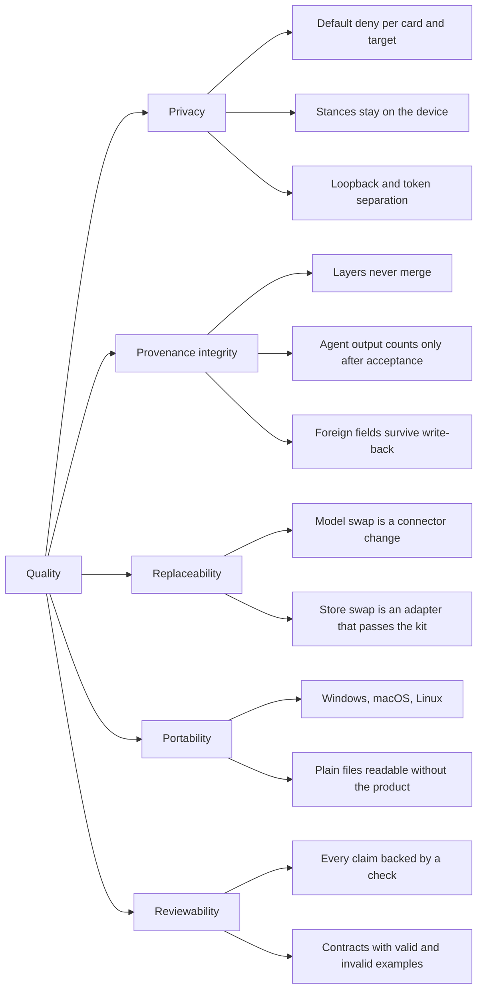

# 10. Quality requirements

The top five quality goals are in [section 1.2](./01-introduction-goals.md#12-quality-goals).
This page refines them into a quality tree and into scenarios that can be tested. A scenario
counts as met only when a check in [verification](../verification.md) proves it; today none
is proven.

## 10.1 Quality tree

## 10.2 Quality scenarios

Each scenario has a stimulus, the expected response and how it is measured. "Check" names the
verification row or the planned test.

### Privacy

| ID | Scenario | Expected response | Check | Status |
| --- | --- | --- | --- | --- |
| QS-P1 | A context package for `cloud_model` is requested for a Lage containing a card with `visibility: private` and no allow rule. | The card is denied with a reason, shown as denied in the preview, and not in the package. | M1-01, AC-26, ADR-C13 | planned (M1) |
| QS-P2 | A user with a fresh installation asks for any context package. | Every card is denied for every target except `screen` (default deny). | ADR-C13 | not started |
| QS-P3 | An agent calls any MCP tool or the Board API to read or write a stance. | No such tool or endpoint exists for agents; stance data never appears in an MCP response, context package or export. | ADR-C14, schema and contract tests | not started |
| QS-P4 | A user confirms a cloud transfer, then the card set changes before sending. | The confirmation no longer matches; nothing is sent until the user confirms the new set. | unit tests of [ADR-0031](../adr/0031-gate-rules-and-confirmation-binding.md) | not started |
| QS-P5 | The service starts with default configuration. | Board API and MCP HTTP listen only on `127.0.0.1`; a request without a token is rejected. | ADR-C15 | not started (default bind exists in the skeleton, untested) |

### Provenance integrity

| ID | Scenario | Expected response | Check | Status |
| --- | --- | --- | --- | --- |
| QS-V1 | An agent proposes a card and nobody accepts it. | It appears only as a pending proposal; rules, statistics, source profiles and the training export ignore it; context packages list it only in the proposals section. | unit tests with mixed fixtures ([ADR-0011](../adr/0011-agent-moves-are-proposals.md)) | not started |
| QS-V2 | An adapter patches one field of a store card that also contains fields the product does not know. | The file is byte-identical except for that field. | conformance kit (M1-02) | not started |
| QS-V3 | Ten cards quote the same agency report. | The board shows "10 findings · 1 origin". | AC-29 | not started |
| QS-V4 | A player-field entry without a source is saved. | Rejected by schema validation. | AC-28 | not started |
| QS-V5 | A board shows evidenced, said and experience cards and the user's stances. | No number on screen combines layers or folds a stance into a layer. | AC-01 | not started |

### Replaceability

| ID | Scenario | Expected response | Check | Status |
| --- | --- | --- | --- | --- |
| QS-R1 | A user switches the target of a context package from a local model to a cloud model. | Only the connector and the gate target change; core and stores are untouched. | AC-14 | not started |
| QS-R2 | A contributor writes a `StorageAdapter` for a new store. | The adapter is accepted when it passes the conformance kit, without changes to core. | M1-02 | not started |
| QS-R3 | The derived index is deleted. | It is rebuilt from the files and query results are identical. | conformance kit ([ADR-0006](../adr/0006-files-are-the-truth.md)) | not started |
| QS-R4 | The canvas library is replaced. | Persisted Lagen are unaffected, because only the Lage format is stored. | design review ([ADR-0019](../adr/0019-design-tokens-and-board-canvas.md)) | not started |

### Portability

| ID | Scenario | Expected response | Check | Status |
| --- | --- | --- | --- | --- |
| QS-O1 | The full test suite and later the M1 scenario run on Windows, macOS and Linux. | All green on all three. | M0-04, M1-03 | in progress (matrix exists; no CI run yet) |
| QS-O2 | The same store card is read on two machines. | Same canonical id on both. | conformance kit ([ADR-0023](../adr/0023-core-domain-model.md)) | not started |
| QS-O3 | The user opens their world folder without the Worldbuilder. | Every card, Lage and decision is a readable Markdown file. | reference format ([card format](../reference/card-format.md)) | by design, not tested |

### Reviewability

| ID | Scenario | Expected response | Check | Status |
| --- | --- | --- | --- | --- |
| QS-W1 | A README or docs page claims a feature. | A row in verification names the test and CI job, or the claim is labelled "in progress". | review checklist, [verification](../verification.md) | in progress |
| QS-W2 | A schema changes. | The pull request contains an ADR, a version bump, and valid and invalid examples that the CI validates. | ADR-C05, review | in progress |
| QS-W3 | A docs page links to a missing page or anchor. | The docs build fails. | M0-09 | in progress (passes locally; no CI run yet) |
