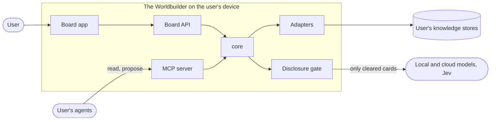

# Architecture

This is the architecture documentation of The Worldbuilder, structured after the
[arc42](https://arc42.org/overview) template, with diagrams in the
[C4 model](https://c4model.com/) notation, written as Mermaid text in this folder.

The [ADR log](../adr/) is normative. These pages explain how the decisions fit together and
never restate an ADR in full; where a page and an ADR disagree, the ADR wins and the page is a
bug.

::: warning What exists today
**Milestone M0 is in progress. Nothing described here is a working feature yet.** M0 delivers
contracts, tooling and documentation only. Every building block, interface and runtime
scenario on these pages carries one of these labels:

| Label | Meaning |
| --- | --- |
| **exists (M0 skeleton)** | Present on the trunk as a package skeleton, configuration or document. No product behaviour. |
| **in progress (M0)** | Contract work under review and not on the trunk yet (JSON Schemas, OpenAPI, MCP tool definitions, adapter interfaces). |
| **planned (M1)** | Part of the walking skeleton, proven by one Playwright end-to-end test in CI. |
| **planned (M2+)** | A later vertical slice. See the [roadmap](../roadmap.md). |
| **later** | Outside the current milestones (platform, sharing). Data model kept open only. |

The [verification table](../verification.md) is the record of what an automated check proves.
:::

## Pages

| arc42 section | Page | Content |
| --- | --- | --- |
| 1 | [Introduction and goals](./01-introduction-goals.md) | What the system is for, top quality goals, stakeholders |
| 2 | [Constraints](./02-constraints.md) | Technical, organisational and legal constraints, conventions |
| 3 | [Context and scope](./03-context-scope.md) | C4 system context: user, agents, models, Jev, knowledge stores, sources |
| 4 | [Solution strategy](./04-solution-strategy.md) | The few ideas that shape everything else |
| 5 | [Building blocks](./05-building-blocks.md) | C4 container view, package responsibilities and dependency rules |
| 6 | [Runtime view](./06-runtime.md) | Sequence diagrams: M1 walking skeleton, Level 1 through a cloud engine, write-back patch |
| 7 | [Deployment view](./07-deployment.md) | Local single-user installation, self-hosting, Windows, macOS and Linux |
| 8 | [Crosscutting concepts](./08-crosscutting.md) | Domain model, provenance, privacy, identity, persistence, security, testing |
| 9 | [Architecture decisions](./09-decisions.md) | Pointer into the ADR log, grouped by concern, plus open decisions |
| 10 | [Quality requirements](./10-quality.md) | Quality tree and testable quality scenarios |
| 11 | [Risks and technical debt](./11-risks-debt.md) | What can go wrong and what we owe |
| 12 | [Glossary](./12-glossary.md) | Pointer to the project glossary, plus architecture terms |

## At a glance

The board app talks to the Board API, agents talk to the MCP server, and both front ends use
the same domain core, which has no I/O. Every
store is reached through an adapter, and everything that leaves the device passes the
disclosure gate. The [container view](./05-building-blocks.md#52-level-1-container-view) has
the details.

## Relation to the UX specification

UX and architecture are separate documents on purpose, and the architecture is not derived
from screens. The [Board UX](../product/board-ux.md) specification says what a person sees
and does. These pages say which building block is responsible for it and through which
contract. The links between the two are:

| UX topic | UX specification | Architecture |
| --- | --- | --- |
| Layers and the stance overlay | [Visual grammar](../product/board-ux.md#layers-and-the-stance-overlay) | [Domain model](./08-crosscutting.md#81-domain-model), [privacy](./08-crosscutting.md#83-privacy-and-the-disclosure-gate) |
| Rules panel | [Rules panel](../product/board-ux.md#6-rules-panel) | [Building blocks: core](./05-building-blocks.md#53-responsibilities) |
| Inbox of findings | [Inbox](../product/board-ux.md#7-inbox-new-findings-from-connected-sources) | [Context: sources](./03-context-scope.md#32-technical-context) |
| Seats and agent proposals | [Seats and agent proposals](../product/board-ux.md#8-seats-and-agent-proposals) | [Runtime: walking skeleton](./06-runtime.md#61-m1-walking-skeleton) |
| Thinking levels | [Thinking levels](../product/board-ux.md#9-thinking-levels) | [Runtime: Level 1 through a cloud engine](./06-runtime.md#62-level-1-prediction-through-a-cloud-engine) |
| Disclosure gate and cloud warning | [Disclosure gate](../product/board-ux.md#10-disclosure-gate-and-cloud-warning) | [Privacy](./08-crosscutting.md#83-privacy-and-the-disclosure-gate) |
| Decision card | [Decision card](../product/board-ux.md#11-decision-card) | [Domain model](./08-crosscutting.md#81-domain-model) |
| Source profile | [Source profile](../product/board-ux.md#12-source-profile) | [Building blocks: core](./05-building-blocks.md#53-responsibilities) |

The example scenarios (Hormuz, Palma) are in [Scenarios](../product/scenarios.md). The
reference scenario for M1 is Hormuz.

## How to change these pages

- A change that alters a decision needs an ADR first
  ([ADR-0001](../adr/0001-record-architecture-decisions.md)); then update the affected page.
- Diagrams are Mermaid in the Markdown source. Keep each diagram's table of elements next to
  it, so the content stays readable where Mermaid does not render.
- Do not mark anything as built unless a check in [verification](../verification.md) proves
  it.
