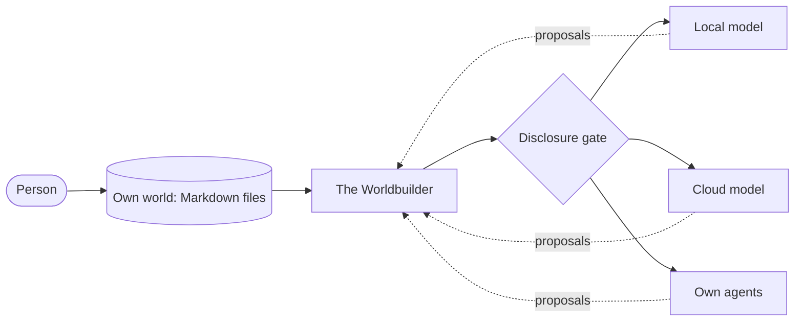

# Why the LLM is replaceable

> The model is replaceable. Your personal world is not.

## The idea

Most AI systems sit on a few large models, with their training data, system limits and
gatekeepers. Whatever you tell such a model lives, in practice, inside that provider. Change
provider and you start again.

The Worldbuilder puts a layer of its own between you and any model or agent. Your knowledge,
your decisions and the provenance of both live in **your** files. Models and agents are
exchangeable execution layers that read from that world and may propose additions to it.

## How the architecture makes it true

- **Files are the truth** ([ADR-0006](../adr/0006-files-are-the-truth.md)). Cards are Markdown with YAML front matter. Any database or index
  is derived and can be deleted and rebuilt. No model, and no service of ours, holds the only
  copy.
- **Adapters at every edge** ([ADR-0005](../adr/0005-universal-adapter-architecture.md)). A `StorageAdapter` reads and writes the user's store. A
  `SourceConnector` reports new findings from connected sources. A `ModelConnector` talks to
  a model. A `DisclosureGate` decides what may leave. Swapping a model changes one connector,
  not the world.
- **Context packages, not memory.** A model is not trained on your world. For each request,
  the system selects the active world's relevant cards, relations, decisions and provenance
  and hands the model a context package. The same package can go to a local model, a cloud
  model or your own agent. The world stays outside the model.
- **A narrow door for agents** ([ADR-0011](../adr/0011-agent-moves-are-proposals.md), [ADR-0016](../adr/0016-mcp-first-and-openapi-contracts.md)). Agents reach the world through MCP tools. Their only write
  path is `proposal_create`. A human accepts or rejects. So replacing an agent cannot
  silently change your world.
- **A gate that defaults to deny** ([ADR-0012](../adr/0012-disclosure-gate.md)). What leaves the device is decided per card and per target
  (`screen`, `local_model`, `cloud_model`, `demo`). A cloud transfer needs per-transfer
  confirmation. Your stances never leave the screen.

## Why facts are not fine-tuned into a model

Fine-tuning feels like the obvious way to "teach a model your world". The project does not
use it for facts:

- Model weights cannot carry provenance, so a trained fact loses its source.
- Weights cannot hold the split between evidenced and said.
- A fact baked into a model cannot be corrected, withdrawn or restricted by the gate.
- A trained model is bound to one provider's base model. That is the lock-in the project
  exists to avoid.

Facts stay retrievable cards. What *may* be trained is the **decision style**: decision
cards with reasoning and outcome, and brainstorm traces. That is optional and only for cards
marked `training: true`, with consent per card. A training export is a plain JSONL file of
decision traces ([ADR-0017](../adr/0017-decision-card-and-training-export.md)). The export is decided like a cloud transfer, with a per-export confirmation, and never contains stances. Fine-tuning itself only makes sense after enough decisions with outcomes
exist and a measured consistency test shows it beats the base model with a context package.
Nothing is trained by this repository.

## Two thinking levels, any engine

The same principle applies to quick answers. A Level 1 answer ([ADR-0015](../adr/0015-two-thinking-levels.md)) comes from an engine that can
be the local rules engine, a small local model or an external decision service. It is shown
as "`<engine>` estimates 0.82 for X", never as the system's verdict, and can be escalated to
the board. The engine can change; the world and the board do not.

## What the model is for

A model is a sparring partner. It reads a context package, answers and proposes. It never
sets your stance, never merges layers and never decides. You do.

## Related

[Why layers never merge](./layers-never-merge.md) ·
[Provenance and independence](./provenance-and-independence.md) ·
[Vision](../product/vision.md)
